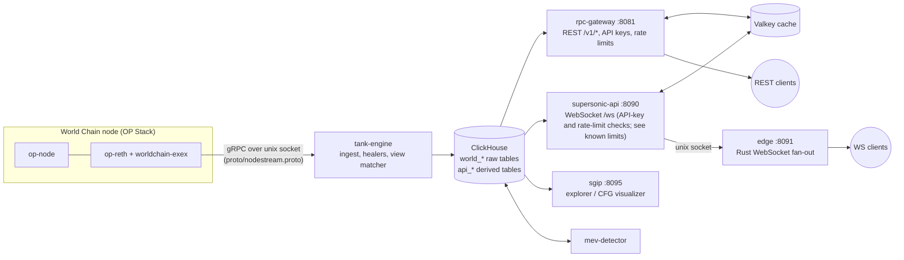

# Worldchain Supersonic

[](LICENSE)


Real-time indexing and API infrastructure for **World Chain** (OP-Stack L2, chain id 480).
It taps a reth node in-process, writes every block, transaction, call trace and log into ClickHouse,
derives DeFi / token / MEV views from them, and serves the result over REST and WebSocket.

> **How this was built.** The architecture, data model and operational decisions are by the project owner.
> AI coding agents assisted with implementation (code generation, refactoring, tests and review) under that
> human direction. Treat the code as you would any fast-moving, partly machine-written codebase: read it before you rely on it.

## Why Supersonic

Supersonic is an integrated stack for working with World Chain at the execution level, from the node to an investigation UI, on infrastructure you operate. In this repository:

* **Execution-level indexing.** `worldchain-exex` runs as a reth Execution Extension inside `op-reth` and streams each committed block (header, transactions, call traces, logs) to `tank-engine` over gRPC on a unix socket.
* **Raw data in a database you control.** Blocks, transactions, call traces and logs are written to your own ClickHouse (`world_blocks`, `world_transactions`, `world_traces`, `world_logs`), so you can query them directly with SQL.
* **Derived datasets.** `tank-engine` derives token transfers, DEX swaps and DeFi events from the raw data, and `mev-detector` adds MEV rows (priority bribes, bot spam, atomic arbitrage and sandwich candidates). `mev-detector` runs as a separate process over blocks that are already fully ingested, in chunks, so MEV rows trail the chain head.
* **REST and WebSocket access.** `rpc-gateway` serves `/v1/*` REST (see [`docs/openapi.yaml`](docs/openapi.yaml)) with API-key tiers and rate limits; `cmd/api` exposes `/ws` with API-key and rate-limit checks that refuse requests (503) while they cannot run; the unauthenticated `edge` WebSocket is disclosed under known limits below.
* **Investigation graphs (SGIP).** `sgip` renders transaction call-trace graphs and contract and wallet views from the indexed data, and renders a contract's control-flow graph (CFG) when one is stored for it. The decompiler that produces stored CFGs is not part of this repository.
* **One workflow.** Extraction (ExEx) → indexed datasets (ClickHouse) → APIs (REST/WebSocket) → investigation UI (SGIP).

Dated scale measurements and the known limits (including that the ExEx has only been compile-verified against unmodified upstream reth, not run end to end, and may differ from the production build) are under [What is live and what is not](#what-is-live-and-what-is-not-known-limits).

## Product direction

Supersonic is being extended into one complete investigation workflow: an agent pays for a derived execution-level lead, follows the same transaction hash into SGIP, and receives a replayable response with its evidence context. The ambition is to make Supersonic the most direct path from World Chain activity to inspectable evidence.

Planned product capabilities (specifications; implementation status called out below):

1. **x402 pay-per-request data access** with Circle Gateway nanopayments in USDC on Arc ([specification](docs/hackathon/01-x402-arc-gateway.md)).
2. **World ID gating with IDKit** for one active self-service free-tier key per action-scoped nullifier ([specification](docs/hackathon/02-world-id-gating.md)).
3. **World ID Agent Pass**, separate from IDKit, for fresh human approval of one paid or elevated data request. Approval never replaces payment ([specification](docs/hackathon/04-agent-pass.md)).
4. **ENS name inputs** for address parameters, resolved before payment and pinned through fulfillment ([specification](docs/hackathon/03-ens-integration.md)).

Each capability must strengthen the same request → authorize → investigate → replay workflow. The product story is not a sequence of disconnected integrations. A labelled public fixture and one-command REST/SGIP verification are planned to make the investigation reproducible without production access ([specification](docs/hackathon/05-investigation-evidence.md)); neither is an existing result.

### Frozen Mumbai submission slice (event work in progress)

For ETHGlobal Mumbai, implementation is **frozen** to one vertical slice (see [CONTINUITY.md](CONTINUITY.md)):

**Arc Studio UI → real HTTP seller → Circle Gateway / Arc Testnet → existing Go API `/v1/mev/analytics` → stored response/receipt → SGIP graph for the same investigated World Chain `tx_hash`.**

| Piece | Status |
|---|---|
| Experimental TypeScript seller **engine** (`x402-seller/`) | Draft PR [#23](https://github.com/ozzyshaik-org/world-supersonic-public/pull/23) head `f79de2f` — **experimental seller-engine checkpoint** only; local `unit-fake` / `contract-real-local` evidence in [EVIDENCE.md](EVIDENCE.md). Not live Arc/Circle. |
| Real HTTP adapter around the engine | Draft PR [#25](https://github.com/ozzyshaik-org/world-supersonic-public/pull/25) head `b03d41e` — **local-http-integration + unit-fake Gateway** only (137/137). **Not** live Arc/Circle |
| Arc Studio UI / Studio URL | `MISSING` until the owner supplies a project |
| Live Gateway / Arc Testnet payment, batching, settlement, public demo, video | `NOT_YET_RUN` / `MISSING` — keep [EVIDENCE.md](EVIDENCE.md) ARC live rows as written |
| IDKit, Agent Pass, ENS, other partners, pstack formal verification | **Deferred, not started** until the paid `/v1/mev/analytics` flow and its evidence are complete |

The Arc **payment** transaction/transfer ID is always separate from the investigated World Chain `tx_hash`. Do not present `/v1/balance` as a wallet balance. Slice diagram and demo script drafts: [docs/ARCHITECTURE_SLICE.md](docs/ARCHITECTURE_SLICE.md), [docs/DEMO_SCRIPT.md](docs/DEMO_SCRIPT.md).

## Product website

[`website/`](website/) contains the source for Supersonic's interactive product website and guided four-minute pitch. It presents the existing public core through a synthetic investigation workspace, procedural technical models, source-level references and explicitly labelled roadmap specifications. It is frontend-only: no chain query, payment, identity check, settlement, account or backend persistence is performed.

**Public product website:** <https://ozzyshaik-org.github.io/world-supersonic-public/>.

The product website is **not** the planned Arc Studio event frontend and is not evidence that Arc/x402, IDKit, Agent Pass or ENS has been implemented or run. Website commits before the start tag are pre-kickoff product/presentation work under the Continuity split.

```bash
cd website
npm ci
npm run check
npm run build
```

See [`website/README.md`](website/README.md) for development and preview commands, pitch controls, evidence states, the source-reference map, deployment and browser-verification scope.

## ETHGlobal Mumbai 2026 (Continuity Track)

This product direction is the planned extension for the Continuity Track at ETHGlobal Mumbai (5-7 Nov 2026). Official hacking start: **2026-11-05 21:00:00 IST**. Pre-existing work is the annotated tag `baseline-pre-ethglobal-mumbai` plus every commit reachable from the start tag other than the Corrected Variant B exception below: documentation and CI, and also build, schema, lockfile, product-website and existing-core code fixes (the merged pull requests are listed in [CONTINUITY.md](CONTINUITY.md)). The annotated start tag `ethglobal-mumbai-2026-start` is on origin (tag object `7993c080fa47d3f15e584795fcb4bd59c0250012`, peeled commit `cb39dbb3d2dbf217949ef279c7e526c543c0b7ea`) and must never be moved or backdated. Under **Corrected Variant B**, PR #21's seven branch commits remain pre-existing; only merge commit `cb39dbb` is event-period administrative/documentation work; no part of PR #21 is an event-built feature; commits after the start tag are event work. See [CONTINUITY.md](CONTINUITY.md) and [HACKATHON_LOG.md](HACKATHON_LOG.md) for the full split.

**Open-source rule.** ETHGlobal's rules for Continuity-track submissions say: "All new parts of extending an existing project must remain open source." ([ethglobal.com/rules](https://ethglobal.com/rules), read 2026-10-27.) Every new part of the submitted extension remains public under the repository's open-source license. Credentials, private data and sensitive live-infrastructure details are redacted. No submitted feature or required implementation is hidden or misrepresented.

Supporting documents: [AI_USAGE.md](AI_USAGE.md) (baseline AI usage and human contributions, plus event-period per-file attribution for `x402-seller/`; UI/media asset inventory of the existing assets is included; origin of those assets is not confirmed), [EVIDENCE.md](EVIDENCE.md) (evidence register; local `unit-fake` / `contract-real-local` seller-engine verification recorded; **no** live ARC row marked passed), [DEMO_PLAN.md](DEMO_PLAN.md) and [docs/DEMO_SCRIPT.md](docs/DEMO_SCRIPT.md) (demo plan / script drafts, not an existing demo), [docs/ARCHITECTURE_SLICE.md](docs/ARCHITECTURE_SLICE.md) (frozen-slice diagram with status labels), the [submission checklist](docs/hackathon/95-submission-checklist.md) (all boxes unchecked; nothing submitted) and the [AI artifact plan](docs/hackathon/96-ai-artifact-plan.md) (plan only; no prompts published yet). Detailed track constraints, integration criteria and evidence requirements remain in those documents rather than interrupting the product overview above.

## Architecture



## Services

| Directory | Language | Port | What it does | State on 2026-10-24 |
|---|---|---|---|---|
| `exex/` | Rust (reth ExEx) | unix socket | Streams committed blocks (header, txs, traces, logs) out of `op-reth` | Running in production. Public build compile-verified with `--locked` against unmodified upstream reth (not run end to end; production uses a locally modified reth checkout that is not published, see `exex/README.md`) |
| `tank-engine/` | Rust | – | Consumes the ExEx stream, writes ClickHouse, backfills and heals gaps, matches logs into derived `api_*` tables | Running in production (`cargo check` passes) |
| `cmd/rpc-gateway/` | Go | 8081 | REST API `/v1/*`, Valkey cache + singleflight, API-key tiers and rate limits, Prometheus `/metrics`, Swagger `/docs` | Running; `go build`/`go vet` pass |
| `cmd/api/` + `web/` | Go | 8090 | WebSocket `/ws` with API-key and rate-limit checks (see known limits) that polls recent DEX/DeFi/NFT rows and pushes them to the edge and, in this repository, to its own `/ws` clients; serves a static page | Running; `go build`/`go vet` pass |
| `edge/` | Rust (axum) | 8091 | WebSocket fan-out of messages received from supersonic-api over a unix socket; its `/ws` is unauthenticated (see known limits) | Running (`cargo check` passes) |
| `sgip/` | Python (FastAPI) | 8095 | Contract / transaction / wallet explorer and control-flow-graph visualizer over ClickHouse | Running |
| `mev-detector/` | Python | – | Scans indexed blocks for MEV patterns into `world_mev_activity`; optional Telegram/Discord alerts | Running |
| `schema/` | SQL | – | ClickHouse DDL (tables, materialized views) | Reference dumps |
| `proto/` | protobuf | – | ExEx → tank-engine stream definition | – |
| `docs/openapi.yaml` | OpenAPI 3.0 | – | REST surface of the gateway | – |
| `x402-seller/` | TypeScript | – | Experimental off-chain x402 seller **engine** + thin local HTTP adapter (settle-before-fulfill); FAKE Gateway in unit/local-http tests | Engine checkpoint draft PR #23 (`f79de2f`); HTTP adapter draft PR #25 (`b03d41e`, local-http-integration + unit-fake); **not** live Arc/Circle |

## What is live and what is not (known limits)

Measured read-only against the production deployment on 2026-10-24 (approximate figures, rounded):

* The indexer was **at chain head** (indexed block ≈ 36.7 M, ingestion lag 0 blocks, node not syncing).
* ClickHouse held nearly 30 billion rows across ~55 tables: ≈ 36.7 M blocks, ≈ 720 M transactions,
  ≈ 6.9 B logs, ≈ 17.6 B call traces, ≈ 2.1 B token transfers, ≈ 177 M DEX swaps, ≈ 1.1 M MEV rows.
* Ingestion into this database started **2026-03-15** (earliest ingest timestamp); chain history before that was backfilled.

Not live / not finished — said plainly:

* **World ID classification** (`WORLD_ID_VERIFIED` in `tank-engine/src/mv_matcher.rs`, `api_humanity_feed` view) is implemented,
  but the production tables had **no matching rows** on 2026-10-24. Treat it as untested against live data.
* `POST /v1/auth/keys` was an open endpoint in production at that date. In **this** repository it requires `X-Admin-Token`
  (env `ADMIN_TOKEN`) and is disabled when the variable is unset.
* The gateway's embedded OpenAPI spec lists 5 REST routes; the code registers more (`/v1/defi/events`, `/v1/mev/analytics`,
  `/v1/portfolio`, `/v1/health/system`, `/v1/auth/keys`). `docs/openapi.yaml` documents all of them.
* `edge` `/ws` has no authentication (`edge/src/main.rs` registers `/ws` with no key check and binds `0.0.0.0:8091`). `cmd/api`'s `Gatekeeper` (`cmd/api/main.go`) fails closed: while its key and rate-limit check cannot run (no Valkey client, or the check script returns an error) it answers 503 with `Retry-After: 5` instead of passing the request through, and a Valkey client that could not be created is retried at most once every 5 s. A missing or unknown key gets 401 and a key over its limit 429. The check runs when a `/ws` connection is opened; an open connection is not checked again, so revoking a key does not close connections already open with it.
* API-key revocation is not instant. `rpc-gateway` reads a key with `FINAL` and caches its record for 10 s (in Valkey and in the client-side cache), and `cmd/api` re-reads the active keys every 10 s, so a key set to `is_active = 0` is refused by both once their cached copy expires, normally within about 10 s. This follows from the code and was not measured on a running deployment; it is not a guarantee, and `cmd/api` `/ws` connections already open with the key are not closed.
* CORS is `*` on the gateway and sgip.
* Client address handling in the gateway's rate limiter (`cmd/rpc-gateway/main.go`): `ApiKeyAuthAndRateLimitMiddleware` (line 1359; applied to the `:8081` handler at line 496) takes the client address from `r.RemoteAddr` (lines 1434-1437) and then, whenever an `X-Forwarded-For` header is present, replaces it with the first comma-separated entry of that header, trimmed (lines 1438-1442), with no check on who sent the header. If the resulting string is `127.0.0.1` or `::1`, the request skips the token-bucket rate limit (lines 1443-1446). A supplied API key is validated before this step (a key that does not exist or is inactive gets 401, lines 1413-1419; a failed key lookup gets 503, lines 1403-1411). A request with no key is not refused by this function; it continues with the default limit of 1 request per second with a burst of 5 (lines 1396-1397), and the loopback exemption skips that limit as well. An older `RateLimitMiddleware` (line 385) has the same logic at lines 402-413, but it is not called anywhere in the file. This describes the code only; whether it can be reached in a given deployment depends on what sits in front of the service and was not assessed here. It is a limit of this code, not a finding about any deployment; deployment reachability was not assessed.
* Single-host deployment and no high-availability story. The Go services have only focused unit tests (`go test ./cmd/...`: address normalization, `/v1/balance` database errors, `rpc-gateway` API-key lookups, the `cmd/api` API-key sync, `/ws` Gatekeeper and `/ws` fan-out; the Valkey-backed ones start a local `redis-server` and are skipped when it is not installed); there is no end-to-end test suite.
* An older Go ingester (`internal/tank`) was superseded by `tank-engine` and is not included.
* Deployment files (systemd units, reverse-proxy config, monitoring, node genesis/rollup configs) are intentionally **not** published.

## Quick start (local, partial; these steps were compile-checked but not run end to end)

Requirements: Go ≥ 1.25, Rust stable, ClickHouse, Valkey/Redis, Python 3 (use a virtual environment), and for the Rust crates `protoc` (tank-engine) plus `pkg-config` and OpenSSL development headers (tank-engine).

Notes from a clean-clone run on Debian 13 (these steps are still partial; see the limits below):

* The services read configuration from environment variables; `.env` is not loaded automatically, and it is not safe to `source` as-is (the placeholder values are not valid shell). Export the variables you need before starting a service.
* `pip install` into the system Python fails on current Debian and Ubuntu (PEP 668); create a virtual environment first (`python3 -m venv .venv && . .venv/bin/activate`).
* `schema/quickstart_schema.sql` is the single documented schema path. On an empty ClickHouse it creates the `worldchain` database and the 24 tables that `rpc-gateway`, `api`, `sgip` and `mev-detector` reference (list and source references: `schema/README.md`), and it can be re-run (`CREATE ... IF NOT EXISTS`). Tables only: no data, and the materialized views that fill the `api_*` tables are not published, so those tables stay empty until you populate them. What was checked: the file applies twice on an empty instance, the services start against it, and every SQL statement embedded in the four services analyses against it with no unknown-table or unknown-column errors. No chain or production data was loaded; synthetic rows were used only for the API-key, checkpoint and MEV insert smoke checks, and no end-to-end flow was exercised; some endpoints still return errors on an empty database (see `schema/README.md`). `schema/01_core_schema.sql` and `02_materialized_views.sql` are an older core-only schema that does not match what the services query; `schema/complete_schema.sql` is a raw dump and does not apply as-is.
* The ExEx (`exex/`) did not build from a clean clone without a lockfile in the earlier run; with the committed `exex/Cargo.lock`, `cargo build --release --locked` passes on a fresh clone (compile check only: runtime behaviour was not tested, and production uses a locally modified reth checkout that is not published). Details in `exex/README.md`.
* `tank-engine` builds with the prerequisites above, but at startup it requires a writable ingest-journal directory at `/var/lib/tank-engine/ingest-pending` (path fixed in `tank-engine/src/ingest_journal.rs`) and a live ExEx stream; without them it logs `INGEST_JOURNAL_UNAVAILABLE` and retries.

```bash
cp .env.example .env            # fill in; never commit
# one schema file: creates the `worldchain` database and every table the services reference (empty); safe to re-run
clickhouse-client --multiquery < schema/quickstart_schema.sql

go build -o bin/rpc-gateway ./cmd/rpc-gateway && ./bin/rpc-gateway     # :8081
go build -o bin/api ./cmd/api && ./bin/api                             # :8090
(cd edge && cargo run --release)                                       # :8091
(cd tank-engine && cargo run --release)                                # needs the exex stream socket
(cd sgip && pip install fastapi uvicorn clickhouse-connect psutil && uvicorn main:app --port 8095)
python3 mev-detector/mev_detector.py
```

Without a node running the ExEx there is no data source for `tank-engine`; you can still load your own data into the
`world_*` tables to exercise the APIs.

Create an API key (admin only):

```bash
curl -X POST localhost:8081/v1/auth/keys -H "X-Admin-Token: $ADMIN_TOKEN" \
     -H 'Content-Type: application/json' -d '{"client_name":"demo","tier":"free"}'
```

Tiers: free 2 rps, pro 20 rps, enterprise 100 rps; anonymous callers get 1 rps (burst 5). Send the key as `X-API-Key` or `?api_key=`.

## Security notes

* Credentials come from environment variables only (`.env.example`). Rotate anything that was ever committed to a predecessor repository.
* Run ClickHouse with a password and bind it to localhost.
* Put TLS and a reverse proxy in front of the public ports.

## License

MIT — see [LICENSE](LICENSE).

## Team

- [@ozzyshaik](https://github.com/ozzyshaik): architecture, backend and infrastructure
- [@nasiparveen006](https://github.com/nasiparveen006): business development and product
