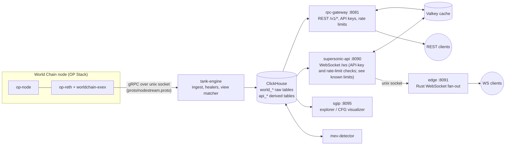

# Worldchain Supersonic

[](LICENSE)


Real-time indexing and API infrastructure for **World Chain** (OP-Stack L2, chain id 480).
It taps a reth node in-process, writes every block, transaction, call trace and log into ClickHouse,
derives DeFi / token / MEV views from them, and serves the result over REST and WebSocket.

> **How this was built.** The architecture, data model and operational decisions are by the project owner.
> AI coding agents assisted with implementation (code generation, refactoring, tests and review) under that
> human direction. Treat the code as you would any fast-moving, partly machine-written codebase: read it before you rely on it.

## Why Supersonic

Supersonic is an integrated stack for working with World Chain at the execution level, from the node to an investigation UI, on infrastructure you operate. In this repository:

* **Execution-level indexing.** `worldchain-exex` runs as a reth Execution Extension inside `op-reth` and streams each committed block (header, transactions, call traces, logs) to `tank-engine` over gRPC on a unix socket.
* **Raw data in a database you control.** Blocks, transactions, call traces and logs are written to your own ClickHouse (`world_blocks`, `world_transactions`, `world_traces`, `world_logs`), so you can query them directly with SQL.
* **Derived datasets.** `tank-engine` derives token transfers, DEX swaps and DeFi events from the raw data, and `mev-detector` adds MEV rows (priority bribes, bot spam, atomic arbitrage and sandwich candidates). `mev-detector` runs as a separate process over blocks that are already fully ingested, in chunks, so MEV rows trail the chain head.
* **REST and WebSocket access.** `rpc-gateway` serves `/v1/*` REST (see [`docs/openapi.yaml`](docs/openapi.yaml)) with API-key tiers and rate limits; `cmd/api` exposes `/ws` with API-key and rate-limit checks; the current Valkey fail-open behavior and unauthenticated `edge` WebSocket are disclosed under known limits below.
* **Investigation graphs (SGIP).** `sgip` renders transaction call-trace graphs and contract and wallet views from the indexed data, and renders a contract's control-flow graph (CFG) when one is stored for it. The decompiler that produces stored CFGs is not part of this repository.
* **One workflow.** Extraction (ExEx) → indexed datasets (ClickHouse) → APIs (REST/WebSocket) → investigation UI (SGIP).

Dated scale measurements and the known limits (including that the ExEx has only been compile-verified against unmodified upstream reth, not run end to end, and may differ from the production build) are under [What is live and what is not](#what-is-live-and-what-is-not-known-limits).

## ETHGlobal Mumbai 2026 (Continuity Track)

This project is the base for the Continuity Track at ETHGlobal Mumbai (5-7 Nov 2026). Pre-existing work is the annotated
tag `baseline-pre-ethglobal-mumbai` plus every commit made before the start tag: documentation and CI, and also build, schema and lockfile work (all of it before `ethglobal-mumbai-2026-start`). Event work is everything after
the annotated tag `ethglobal-mumbai-2026-start`, which is created immediately before event implementation begins. See [CONTINUITY.md](CONTINUITY.md) for the full split.

**Open-source rule.** ETHGlobal's rules for Continuity-track submissions say: "All new parts of extending an existing project must remain open source." ([ethglobal.com/rules](https://ethglobal.com/rules), read 2026-10-27.) Every new part added during the event, including the seller service, the web UI and the Agent Pass, IDKit and ENS code, stays in this public repository under its open-source license, and nothing event-built is kept private.

Supporting documents (pre-start documentation; templates and plans, not results): [AI_USAGE.md](AI_USAGE.md) (baseline AI usage and human contributions; UI/media asset inventory of the existing assets is included; origin of those assets is not confirmed), [EVIDENCE.md](EVIDENCE.md) (evidence register, nothing run yet) [DEMO_PLAN.md](DEMO_PLAN.md) (demo plan, not an existing demo), the [submission checklist](docs/hackathon/95-submission-checklist.md) (all boxes unchecked; nothing submitted) and the [AI artifact plan](docs/hackathon/96-ai-artifact-plan.md) (plan only; no prompts published yet).

Planned during the hackathon (committed scope—specifications only, not yet implemented):

1. **x402 pay-per-request data access** with Circle Gateway nanopayments in USDC on Arc.
2. **World ID gating with IDKit**: one active self-service free-tier key per action-scoped nullifier.
3. **World ID Agent Pass: human checkpoint for one paid or elevated data request**, third priority: an agent proposes the request, the backend pauses it, and a human completes fresh Agent Pass authentication and then separately approves or denies the exact displayed action in our application; Agent Pass approval never replaces Arc/x402 payment. Attempted after the Arc and IDKit flows work end to end, with their demos, tests and evidence complete ([spec](docs/hackathon/04-agent-pass.md)).
4. **ENS name inputs for address parameters**, fourth priority: attempted after the Agent Pass flow works end to end, with its demo, tests and evidence complete ([spec](docs/hackathon/03-ens-integration.md)).

Arc x402 and World ID IDKit are the core priorities. World ID Agent Pass is a separate official integration from IDKit and is never conflated with it; they are distinct targets with separate evidence. Two uncommitted stretch options (not part of the committed scope, and attempted only after items 1 to 4 are complete and evidenced) are listed in [docs/hackathon/90-stretch-options.md](docs/hackathon/90-stretch-options.md).

### Partner prize targets (Continuity)

Arc and World are the current prize targets. The two World rows each target only the Continuity-only listing named in that row; both are pending confirmation, and final prize terms must be rechecked against the official prize pages before submission. ENS is a conditional prize consideration. No selection, eligibility or winnings are claimed for any row. Each feature has a definition of done. All new work is committed to this public repository.

| Track | Feature (spec) | Done means |
|---|---|---|
| Arc: Bring Your Project to Arc | [x402](docs/hackathon/01-x402-arc-gateway.md) pay-per-request access, paid in USDC through Circle Gateway nanopayments, started from Arc Studio | A request to a paid `/v1` route returns HTTP 402; the client retries with a signed payment authorization; the seller validates it, submits it to Circle Gateway and, once Gateway accepts it, fulfills the request; a retry of the same request is never charged twice and nonce reuse for a different request is rejected; paid routes cannot be bypassed through direct access. Circle Gateway, not the seller, later batches the accepted transfers and settles them onchain on Arc, and the seller only observes that. Per-request onchain settlement is not claimed. Arc Studio URL, Studio shown in the demo, an Arc Studio-built web frontend and the seller backend, architecture diagram, integration feedback, demo URL and open-source code. |
| World: [Cont] Best IDKit Use Case (Continuity-only listing; target pending confirmation) | [One active self-service free-tier key per action-scoped nullifier](docs/hackathon/02-world-id-gating.md) with World ID | A self-service key is minted only after a World ID proof, a second self-service key for the same action-scoped nullifier is refused, lost-key recovery with a fresh proof replaces the key without a new nullifier, and a revoked key is refused on `/v1` and `/ws`. Operator-minted keys are a separate documented exception and are not part of the human-flow demo. |
| World: Agent Pass (Continuity-only listing; target pending confirmation) | [Human checkpoint for one paid or elevated data request](docs/hackathon/04-agent-pass.md) with World ID Agent Pass | Separate from the IDKit row. The ETHGlobal World prizes page lists "World ID Agent Pass" with the notice "This prize is only available to Continuity Track participants"; it does not use the label "Continuity Agent Pass", and the target is pending confirmation against the final prize terms (a separate, general Agent Pass listing also exists and is not claimed here). Done means, per the spec: an agent request is paused with the exact operation stored; fresh authentication is completed and validated by the backend; the human separately approves the displayed action in our application; the approved operation executes at most once and never replaces Arc/x402 payment; denied, cancelled, expired, mismatched, changed-request and replayed attempts leave the action unexecuted; the integration debrief is written from real experience. |
| ENS (conditional prize consideration) | [ENS name inputs for `/v1/balance` and `/v1/transactions`](docs/hackathon/03-ens-integration.md) | Fourth priority; no prize claim. Eligibility only if ENSv2 on Ethereum mainnet is used in a functional, central way; none is claimed for ordinary `.eth` resolution alone. Done criteria are in the spec. |

## Architecture



## Services

| Directory | Language | Port | What it does | State on 2026-10-24 |
|---|---|---|---|---|
| `exex/` | Rust (reth ExEx) | unix socket | Streams committed blocks (header, txs, traces, logs) out of `op-reth` | Running in production. Public build compile-verified with `--locked` against unmodified upstream reth (not run end to end; production uses a locally modified reth checkout that is not published, see `exex/README.md`) |
| `tank-engine/` | Rust | – | Consumes the ExEx stream, writes ClickHouse, backfills and heals gaps, matches logs into derived `api_*` tables | Running in production (`cargo check` passes) |
| `cmd/rpc-gateway/` | Go | 8081 | REST API `/v1/*`, Valkey cache + singleflight, API-key tiers and rate limits, Prometheus `/metrics`, Swagger `/docs` | Running; `go build`/`go vet` pass |
| `cmd/api/` + `web/` | Go | 8090 | WebSocket `/ws` with API-key and rate-limit checks (see known limits) that polls recent DEX/DeFi/NFT rows and pushes them to the edge; serves a static page | Running; `go build`/`go vet` pass |
| `edge/` | Rust (axum) | 8091 | WebSocket fan-out of messages received from supersonic-api over a unix socket; its `/ws` is unauthenticated (see known limits) | Running (`cargo check` passes) |
| `sgip/` | Python (FastAPI) | 8095 | Contract / transaction / wallet explorer and control-flow-graph visualizer over ClickHouse | Running |
| `mev-detector/` | Python | – | Scans indexed blocks for MEV patterns into `world_mev_activity`; optional Telegram/Discord alerts | Running |
| `schema/` | SQL | – | ClickHouse DDL (tables, materialized views) | Reference dumps |
| `proto/` | protobuf | – | ExEx → tank-engine stream definition | – |
| `docs/openapi.yaml` | OpenAPI 3.0 | – | REST surface of the gateway | – |

## What is live and what is not (known limits)

Measured read-only against the production deployment on 2026-10-24 (approximate figures, rounded):

* The indexer was **at chain head** (indexed block ≈ 36.7 M, ingestion lag 0 blocks, node not syncing).
* ClickHouse held nearly 30 billion rows across ~55 tables: ≈ 36.7 M blocks, ≈ 720 M transactions,
  ≈ 6.9 B logs, ≈ 17.6 B call traces, ≈ 2.1 B token transfers, ≈ 177 M DEX swaps, ≈ 1.1 M MEV rows.
* Ingestion into this database started **2026-03-15** (earliest ingest timestamp); chain history before that was backfilled.

Not live / not finished — said plainly:

* **World ID classification** (`WORLD_ID_VERIFIED` in `tank-engine/src/mv_matcher.rs`, `api_humanity_feed` view) is implemented,
  but the production tables had **no matching rows** on 2026-10-24. Treat it as untested against live data.
* `POST /v1/auth/keys` was an open endpoint in production at that date. In **this** repository it requires `X-Admin-Token`
  (env `ADMIN_TOKEN`) and is disabled when the variable is unset.
* The gateway's embedded OpenAPI spec lists 5 REST routes; the code registers more (`/v1/defi/events`, `/v1/mev/analytics`,
  `/v1/portfolio`, `/v1/health/system`, `/v1/auth/keys`). `docs/openapi.yaml` documents all of them.
* `edge` `/ws` has no authentication (`edge/src/main.rs` registers `/ws` with no key check and binds `0.0.0.0:8091`). `cmd/api` fails open on key checks if Valkey is unavailable: in `Gatekeeper` (`cmd/api/main.go`), if the Valkey client could not be created, or the key/rate-limit check script returns an error, the request is passed through with no key validation and no rate limit. A request with no `api_key` parameter is still refused (401).
* CORS is `*` on the gateway and sgip.
* Client address handling in the gateway's rate limiter (`cmd/rpc-gateway/main.go`): `ApiKeyAuthAndRateLimitMiddleware` (line 1355; applied to the `:8081` handler at line 493) takes the client address from `r.RemoteAddr` (lines 1420-1423) and then, whenever an `X-Forwarded-For` header is present, replaces it with the first comma-separated entry of that header, trimmed (lines 1424-1428), with no check on who sent the header. If the resulting string is `127.0.0.1` or `::1`, the request skips the token-bucket rate limit (lines 1429-1432). A supplied API key is validated before this step (an invalid or revoked key gets 401, lines 1395-1404). A request with no key is not refused by this function; it continues with the default limit of 1 request per second with a burst of 5 (lines 1393-1394), and the loopback exemption skips that limit as well. An older `RateLimitMiddleware` (line 382) has the same logic at lines 399-410, but it is not called anywhere in the file. This describes the code only; whether it can be reached in a given deployment depends on what sits in front of the service and was not assessed here. It is a limit of this code, not a finding about any deployment, and no change is made in this documentation-only pull request.
* Single-host deployment, no high-availability story, and no automated test suite for the Go services.
* An older Go ingester (`internal/tank`) was superseded by `tank-engine` and is not included.
* Deployment files (systemd units, reverse-proxy config, monitoring, node genesis/rollup configs) are intentionally **not** published.

## Quick start (local, partial; these steps were compile-checked but not run end to end)

Requirements: Go ≥ 1.25, Rust stable, ClickHouse, Valkey/Redis, Python 3 (use a virtual environment), and for the Rust crates `protoc` (tank-engine) plus `pkg-config` and OpenSSL development headers (tank-engine).

Notes from a clean-clone run on Debian 13 (these steps are still partial; see the limits below):

* The services read configuration from environment variables; `.env` is not loaded automatically, and it is not safe to `source` as-is (the placeholder values are not valid shell). Export the variables you need before starting a service.
* `pip install` into the system Python fails on current Debian and Ubuntu (PEP 668); create a virtual environment first (`python3 -m venv .venv && . .venv/bin/activate`).
* `schema/quickstart_schema.sql` is the single documented schema path. On an empty ClickHouse it creates the `worldchain` database and the 24 tables that `rpc-gateway`, `api`, `sgip` and `mev-detector` reference (list and source references: `schema/README.md`), and it can be re-run (`CREATE ... IF NOT EXISTS`). Tables only: no data, and the materialized views that fill the `api_*` tables are not published, so those tables stay empty until you populate them. What was checked: the file applies twice on an empty instance, the services start against it, and every SQL statement embedded in the four services analyses against it with no unknown-table or unknown-column errors. No chain or production data was loaded; synthetic rows were used only for the API-key, checkpoint and MEV insert smoke checks, and no end-to-end flow was exercised; some endpoints still return errors on an empty database (see `schema/README.md`). `schema/01_core_schema.sql` and `02_materialized_views.sql` are an older core-only schema that does not match what the services query; `schema/complete_schema.sql` is a raw dump and does not apply as-is.
* The ExEx (`exex/`) did not build from a clean clone without a lockfile in the earlier run; with the committed `exex/Cargo.lock`, `cargo build --release --locked` passes on a fresh clone (compile check only: runtime behaviour was not tested, and production uses a locally modified reth checkout that is not published). Details in `exex/README.md`.
* `tank-engine` builds with the prerequisites above, but at startup it requires a writable ingest-journal directory at `/var/lib/tank-engine/ingest-pending` (path fixed in `tank-engine/src/ingest_journal.rs`) and a live ExEx stream; without them it logs `INGEST_JOURNAL_UNAVAILABLE` and retries.

```bash
cp .env.example .env            # fill in; never commit
# one schema file: creates the worldchain database and every table the services reference (empty); safe to re-run
clickhouse-client --multiquery < schema/quickstart_schema.sql

go build -o bin/rpc-gateway ./cmd/rpc-gateway && ./bin/rpc-gateway     # :8081
go build -o bin/api ./cmd/api && ./bin/api                             # :8090
(cd edge && cargo run --release)                                       # :8091
(cd tank-engine && cargo run --release)                                # needs the exex stream socket
(cd sgip && pip install fastapi uvicorn clickhouse-connect psutil && uvicorn main:app --port 8095)
python3 mev-detector/mev_detector.py
```

Without a node running the ExEx there is no data source for `tank-engine`; you can still load your own data into the
`world_*` tables to exercise the APIs.

Create an API key (admin only):

```bash
curl -X POST localhost:8081/v1/auth/keys -H "X-Admin-Token: $ADMIN_TOKEN" \
     -H 'Content-Type: application/json' -d '{"client_name":"demo","tier":"free"}'
```

Tiers: free 2 rps, pro 20 rps, enterprise 100 rps; anonymous callers get 1 rps (burst 5). Send the key as `X-API-Key` or `?api_key=`.

## Security notes

* Credentials come from environment variables only (`.env.example`). Rotate anything that was ever committed to a predecessor repository.
* Run ClickHouse with a password and bind it to localhost.
* Put TLS and a reverse proxy in front of the public ports.

## License

MIT — see [LICENSE](LICENSE).

## Team

- [@ozzyshaik](https://github.com/ozzyshaik): architecture, backend and infrastructure
- [@nasiparveen006](https://github.com/nasiparveen006): business development and product
