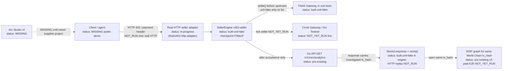

# Architecture: frozen paid `/v1/mev/analytics` slice

Status: **draft diagram for submission planning**. It labels each box by current evidence status. It is not a claim that
live Arc/Circle, Studio, or end-to-end payment has been run.

Official start tag: `ethglobal-mumbai-2026-start` (peeled `cb39dbb3d2dbf217949ef279c7e526c543c0b7ea`). Experimental
seller-engine checkpoint: draft PR [#23](https://github.com/ozzyshaik-org/world-supersonic-public/pull/23) head
`f79de2f36b8a07371b072398ea1e2657775c3a2f`.

**Identity rule:** the Arc **payment** transaction / Gateway transfer ID is always **separate** from the investigated
World Chain `tx_hash` returned by `/v1/mev/analytics` and opened in SGIP.

Do **not** present `/v1/balance` as a wallet balance in this slice.

## Status legend

| Label | Meaning |
|---|---|
| `built-unit-fake` | Implemented and covered by local unit tests with a FAKE Gateway (no live Circle/Arc) |
| `contract-real-local` | Local import/contract check against committed Circle/chain config; no live network |
| `in-progress` | Follow-up work started on another branch; not claimed complete here |
| `NOT_RUN` | Procedure defined; not executed yet on the recorded evidence |
| `NOT_YET_RUN` | Live/partner procedure exists in [EVIDENCE.md](../EVIDENCE.md) and has not been run |
| `MISSING` | Required artifact (URL, video, Studio project) does not exist yet |
| `deferred` | Spec exists; intentionally not started until the Arc slice and its evidence are complete |
| `pre-existing` | Baseline World Chain index / Go API / SGIP (not event-built payment) |

## Slice flowchart

## What is deliberately out of this diagram

- IDKit free-tier mint (`deferred`)
- World ID Agent Pass (`deferred`)
- ENS name inputs (`deferred`)
- pstack formal verification (`deferred`)
- Any claim that unit-fake tests equal live batching or `completed` settlement

## Evidence pointers

- Local seller-engine verification: [EVIDENCE.md — Local verification](../EVIDENCE.md)
- AI attribution for `x402-seller/`: [AI_USAGE.md](../AI_USAGE.md)
- Demo script with the same status labels: [DEMO_SCRIPT.md](DEMO_SCRIPT.md)
