# Feature 1: x402 pay-per-request access (Arc, Circle Gateway, USDC)

Status: committed scope; specification only

Official kickoff on 5 Nov 2026; implementation is event work after the start tag.

## Goal
Let any client, human or AI agent, pay per request for World Chain data in USDC, with no account or API key.

## Design
- A TypeScript x402 seller service, created with Arc Studio (studio.arc.io) and deployed on Arc Testnet, sits in front of the existing Go API.
- The Go API and `cmd/rpc-gateway` are unchanged. The seller service calls the Go API over HTTP with one server-side API key held in its environment, and calls no other application-data upstream. Circle Gateway remains the payment service: the seller calls it to verify and settle payment authorizations, and it carries no application data.
- Seller flow:
  1. A client requests a paid `/v1` route with no payment. The seller responds `402 Payment Required` with machine-readable payment requirements: price, asset (USDC), network (Arc Testnet) and `payTo` address.
  2. The client signs a USDC payment authorization (Circle Gateway nanopayments) and retries the request with the payment header.
  3. The seller verifies the signed authorization with Circle Gateway, records it in the payments ledger and fulfills the request by calling the Go API, following the state machine below.
  4. Fulfilled authorizations are settled later in batch through Circle Gateway on Arc.
- A failed or rejected verification is never fulfilled.
- A per-payer rate limit stops one funded wallet from flooding the Go API.
- Per-route price table: path to price in USDC.
- The committed paid read flow is `GET` with an empty body. Other methods and bodies are outside it (see Request fingerprint).
- Per-request onchain settlement is not claimed. The ledger separates an accepted authorization from a batch settlement that has reached Arc.
- The demo has a public URL.
- The frontend is a web UI built with Arc Studio, and the backend is the seller service. A client uses the web UI to request a paid route, sign the payment authorization and see the fulfilled response and receipt. The one-command CLI demo client is a supplemental test utility, not the sole frontend.

## Authorization key
The ledger needs one stable identifier per payment authorization. The identifier is chosen from what Circle's documentation says about the nonce (all pages read on 2026-10-27):

| Source | What it says |
|---|---|
| [Sign EIP-3009 payment authorizations](https://developers.circle.com/gateway-nanopayments/howtos/eip-3009-signing) | The `nonce` is "a unique random 32-byte value for every payment"; reusing one is rejected. The EIP-712 domain is `GatewayWalletBatched` with the chain ID and the Gateway Wallet address (`verifyingContract`). `validBefore` must be at least 3 days ahead, or the authorization is rejected as `authorization_validity_too_short`. |
| [Gateway Nanopayments SDK reference](https://developers.circle.com/sdks/gateway-nanopayments-sdk) | Error `nonce_already_used`: "Payment nonce was already submitted". Transfer statuses are `received`, `batched`, `confirmed`, `completed` and `failed`. A transfer search can filter by nonce, and by default searches the client's own network. |
| [Reconcile nanopayments as a seller](https://developers.circle.com/gateway-nanopayments/howtos/x402-seller-reconciliation) | A completed request on the seller "confirms only that the payment was accepted, not that it settled". "nonce is unique per payment", so a lookup by nonce "returns at most one transfer". Transfers that end `failed` were "never charged", and the resource must not be fulfilled in that case. |
| [How batched settlement works](https://developers.circle.com/gateway-nanopayments/concepts/batched-settlement) and [Settle an x402 payment](https://developers.circle.com/api-reference/gateway/all/settle-x402payment) | In Circle's documented sequence the seller submits the authorization, Gateway verifies it, locks the buyer's funds and queues it for batch processing, and the seller then serves the resource without waiting for onchain settlement. |
| [EIP-3009](https://eips.ethereum.org/EIPS/eip-3009) | In the base standard, a used nonce is tracked per authorizer: `authorizationState(authorizer, nonce)`. |

**What is not stated:** Circle's pages say the nonce is unique per payment but do not say whether uniqueness is per payer, per chain or global inside Gateway. The base EIP-3009 standard scopes it to the payer on the token contract. This is **to be confirmed against official docs at implementation**.

**Decision (conservative):**
- The stable **authorization key** is the composite `auth_key = <network>|<payer>|<nonce>`: the network exactly as in the accepted payment requirements, the payer address in lowercase `0x` hex, and the nonce as lowercase `0x` plus 64 hex characters, joined by `|`. It is the ledger's primary key and the identifier other components use, so it makes no assumption about Gateway's scope.
- The ledger also keeps a `UNIQUE` index on `nonce` alone. A nonce that is already present under a different payer or network is therefore refused (see the binding rules below) instead of being treated as a new authorization that Gateway might later reject as `nonce_already_used` after the seller had already fulfilled it.
- If Circle confirms per-payer or per-chain scope, relaxing the `nonce` index is a spec amendment, not a silent change.
- A nonce that is not exactly 32 bytes is refused as invalid.

## Request fingerprint
There is exactly one fingerprint algorithm, version `v1`. The seller, the ledger and the Agent Pass operation record in [04](04-agent-pass.md) all compute it with the same function, and the same vectors below are tests in each.

**Scope.** The committed paid read flow is `GET` with an empty body, which fits every route the initial scope uses (`/v1/balance`, `/v1/transactions` and the other read routes in `docs/openapi.yaml` are `GET`). A paid route that takes a request body (for example `POST /v1/auth/keys`) is outside the committed flow. Adding one needs a spec amendment that defines body hashing and a new fingerprint version.

**Rules.**
1. Inputs are the method, the raw request path and the raw query string. Headers (including the payment header and the seller's server-side API key), cookies and the URL fragment are not inputs.
2. **Method:** only `GET`. Any other method on a paid route is refused with `405`, before any fingerprint is computed.
3. **Body:** the request must carry zero body bytes. Any body, even on `GET`, is refused with `400`.
4. **Path:** the raw path must equal a route string in the price table byte for byte, otherwise `404` (no `402` challenge). Nothing is decoded or normalized, so a path with `%`, `//`, a dot segment, a trailing `/` or a different letter case matches no route.
5. **Query parsing:** the raw query is the text after the first `?`; a missing query and an empty query are the same (empty). It must be ASCII with no space, control character or `#`, else `400`. Split on `&`. An empty segment (`a=1&&b=2`, a leading or trailing `&`) is `400`. Split each segment at its first `=`; a segment with no `=`, or with an empty name, is `400`.
6. **Decoding:** percent-decode each name and each value exactly once. `%` must be followed by two hex digits in either case, else `400`. `+` is a literal plus sign, not a space. The decoded bytes must be valid UTF-8, else `400`. No Unicode normalization and no case folding is applied, including to hex addresses.
7. **Names:** every name must be a documented parameter of that route in `docs/openapi.yaml`, else `400`. A name that appears twice after decoding is `400`; duplicates are never merged or reordered.
8. **Encoding:** re-encode each decoded name and value from its UTF-8 bytes. The characters `A-Z a-z 0-9 - . _ ~` stay as they are; every other byte becomes `%XX` with uppercase hex digits. An empty value stays empty (`limit=` is kept, not dropped).
9. **Order:** sort the pairs by the encoded name, comparing bytes, ascending. Join them as `name=value` with `&`, with no leading `?`. No pairs gives an empty string.
10. **Canonical string:** five lines joined by a single line feed (`0x0A`) with no trailing line feed: the label `supersonic-x402-fp-v1`; the method; the path; the canonical query (an empty line when there is none); the literal `body:empty`. A line feed never occurs inside a component (rule 8 encodes one in a value as `%0A`; a method or path cannot contain one), so no component can be shifted across a boundary.
11. **Fingerprint:** SHA-256 of the UTF-8 bytes of the canonical string, written as 64 lowercase hex characters.
12. Any change to these rules gets a new version label. Fingerprints of different versions are never compared.

**Test vectors.** The hashes were computed with a standard SHA-256 tool over the exact canonical string, for example:

```
printf 'supersonic-x402-fp-v1\nGET\n/v1/balance\naddress=0xd8dA6BF26964aF9D7eEd9e03E53415D37aA96045\nbody:empty' | sha256sum
```

| # | Raw request target | Canonical query (line 4) | SHA-256 |
|---|---|---|---|
| 1 | `/v1/balance?address=0xd8dA6BF26964aF9D7eEd9e03E53415D37aA96045` | `address=0xd8dA6BF26964aF9D7eEd9e03E53415D37aA96045` | `ba886fc0227c7de9fec80680d996b742ce885d36acd97586a5356cd5a8beec59` |
| 2 | `/v1/transactions?limit=10&address=0xd8dA6BF26964aF9D7eEd9e03E53415D37aA96045` (also `address=...&limit=10`, and `limit=%31%30`) | `address=0xd8dA6BF26964aF9D7eEd9e03E53415D37aA96045&limit=10` | `d3314b3faa2a2a11d83b5f514d1d1ec618962591f3dcc770eb2e1e22139ff950` |
| 3 | `/v1/transactions?address=0xd8dA6BF26964aF9D7eEd9e03E53415D37aA96045&limit=` (empty value kept) | `address=0xd8dA6BF26964aF9D7eEd9e03E53415D37aA96045&limit=` | `7a16783af6912cf6c09a03ae11ad4ad7171ef16eecd440a27f41273d006f10ca` |
| 4 | `/v1/block/latest` (also `/v1/block/latest?`) | empty line | `e8e05191f29720d69a7662f65ca8c0b9076e8dadfeb9eec249ef884c94f9f317` |
| 5 | `/v1/defi/events?type=a%20b` | `type=a%20b` | `04d6ea2c43828ae69a7f7bf04d7430a9a53e785a3f9fb1eadabf2fd0ec18c183` |
| 6 | `/v1/defi/events?type=a+b` (also `type=a%2bb`) | `type=a%2Bb` | `e3ab72ae336a01e60dafcc38094db160bc37f27a93720962fb429bd7d7651acf` |
| 7 | `/v1/defi/events?type=a%0ab` (a line feed stays encoded) | `type=a%0Ab` | `1a373336c7664e4e6f9a3e5940ce276b61420547766db6c9f973ceb1fa9beace` |
| 8 | `/v1/defi/events?type=%c3%a9` | `type=%C3%A9` | `4a5d45e031dd0ccc18eeaa6fd7972502cdda7d4432aa88598369cd7e452a8def` |
| 9 | `/v1/balance?address=0xd8da6bf26964af9d7eed9e03e53415d37aa96045` (lowercase address: a different request from vector 1) | `address=0xd8da6bf26964af9d7eed9e03e53415d37aa96045` | `6acd3e7a7953ad7ded8fa951d93e494a3e4c1976a6d8750f095bb218da39bc31` |

Vectors 5 and 6 differ on purpose: a space and a plus sign are different values. Vectors 1 and 9 differ on purpose: the fingerprint does no address case folding.

**Rejection vectors** (no fingerprint is produced, no `402` challenge, no upstream call):

| # | Request | Result |
|---|---|---|
| R1 | `GET /v1/transactions?limit=1&limit=2` | `400` duplicate name |
| R2 | `GET /v1/transactions?address=0xd8dA6BF26964aF9D7eEd9e03E53415D37aA96045&&limit=1` | `400` empty segment |
| R3 | `GET /v1/transactions?limit` | `400` segment without `=` |
| R4 | `GET /v1/defi/events?type=%zz` | `400` bad percent escape |
| R5 | `GET /v1/defi/events?type=%FF` | `400` not valid UTF-8 |
| R6 | `GET /v1/balance/?address=0xd8dA6BF26964aF9D7eEd9e03E53415D37aA96045` | `404` no route matches the path |
| R7 | `GET /v1/balance?address=0xd8dA6BF26964aF9D7eEd9e03E53415D37aA96045&x=1` | `400` undocumented parameter |
| R8 | `GET /v1/balance?address=0xd8dA6BF26964aF9D7eEd9e03E53415D37aA96045` with a one-byte body | `400` body not empty |
| R9 | `POST /v1/balance` | `405` method outside the committed paid flow |

## Ledger and authorization binding
The ledger has one row per authorization key. The insert of a new key is atomic, so concurrent first arrivals produce one row. Each row holds the **authorization binding**, written once at insert and never changed:

| Field | Meaning |
|---|---|
| `auth_key`, `nonce` | The composite key above, and the nonce alone (also unique) |
| `network`, `asset`, `pay_to`, `price` | As signed and as required by the price table: network, USDC token address, seller `payTo` address, amount in base units |
| `payer` | The `from` address of the authorization |
| `valid_after`, `valid_before` | The signed validity window |
| `fingerprint` | The `v1` fingerprint of the request the authorization was accepted for |

The row also holds the mutable `state`, the lease owner and expiry, the stored response and receipt once fulfilled, the settlement fields (`batch_id`, `gateway_transfer_id`, `gateway_status`, `settlement_error`), and the stored payment payload that settlement needs. The payload is never logged or returned to a client.

**Binding rule.** A request whose nonce is already in the ledger is a retry of the same authorization only if its payer, network, asset, `payTo`, price, validity window and fingerprint all equal the stored binding. If any one differs, the request is refused with `409` and the code `authorization_binding_mismatch`, in every state. There is no Gateway call, no upstream call, no state change and no charge. A request that matches a stored binding is served from the ledger and is not verified with Circle Gateway again, because Circle rejects a resubmitted nonce.

## Authorization and fulfillment state machine
A recorded nonce is not a consumed nonce. The ledger tracks how far a request got, so a lost upstream response never turns a retry into an "already used" rejection.

```mermaid
stateDiagram-v2
    [*] --> accepted: valid authorization, new key
    accepted --> in_progress: worker takes lease
    in_progress --> fulfilled: upstream 2xx, response and receipt stored
    in_progress --> retryable_failure: upstream error, timeout, lease expiry or validity closed
    retryable_failure --> in_progress: same-request retry takes lease
    accepted --> void: validity window closes
    retryable_failure --> void: validity window closes
    fulfilled --> batched: atomically claimed into a batch
    batched --> settled: Gateway transfer completed
    batched --> settlement_rejected: Gateway rejected or failed the transfer
    batched --> submission_uncertain: outcome of a submission unknown
    submission_uncertain --> batched: reconciled, transfer found or safely resubmitted
    submission_uncertain --> settlement_rejected: reconciled as rejected or failed
```



**Charge wording.** Fulfillment eligibility and settlement are different things, and only the second is a charge.
- *Fulfillment-eligible* means the state is `fulfilled`: exactly one logical response was delivered, so the authorization may be settled once. It is not yet a charge.
- *Charged* means `settled`: the Gateway transfer for this authorization has completed. Until then nothing is claimed as charged. Circle's own guidance is that a completed request on the seller confirms only that the payment was accepted.
- Wherever this spec or the evidence log says "one charge", it means one fulfillment-eligible authorization and at most one settlement.

| State | Meaning | Charge status |
|---|---|---|
| accepted | Authorization verified with Circle Gateway and recorded; no upstream call yet | Not charged |
| `in_progress` | One worker holds a lease and is calling the Go API | Not charged |
| fulfilled | Upstream response stored with a receipt | Fulfillment-eligible, once; not yet settled |
| `retryable_failure` | The upstream call failed, timed out, lost its lease or ran out of validity; the response is not stored | Not charged |
| batched | Claimed into one settlement batch (see Settlement batches); submitted or waiting to be submitted | Not yet settled |
| `submission_uncertain` | A submission to Circle Gateway has an unknown outcome and is being reconciled | Not yet settled |
| settled | The Gateway transfer for this authorization has completed | Charged, once |
| `settlement_rejected` | Gateway rejected the submission or the transfer failed; a failed transfer is never charged | Not charged; flagged as fulfilled but unpaid |
| void | The validity window closed before fulfillment, or the authorization was cancelled before fulfillment | Not charged; terminal |

| From | To | Trigger |
|---|---|---|
| none | accepted | Valid authorization with a key and nonce not in the ledger |
| accepted | `in_progress` | A worker takes the lease with a compare-and-set (and, for an Agent-Pass-protected route, the reservation check in the composition contract) |
| `in_progress` | fulfilled | Go API returns success; response and receipt stored in one transaction, while the validity window is still open |
| `in_progress` | `retryable_failure` | Go API error or timeout, the lease expires without a stored response, or the validity window closes before the commit |
| `retryable_failure` | `in_progress` | A request with the same binding takes the lease |
| fulfilled | batched | The settlement job claims it (see below) |
| batched | settled | The Gateway transfer reports `completed` |
| batched | `settlement_rejected` | A definite Gateway rejection, or the transfer reports `failed` |
| batched | `submission_uncertain` | A submission times out, drops, or returns an indeterminate answer |
| `submission_uncertain` | batched | Reconciliation finds the Gateway transfer, or finds a definite absence and resubmits once, as described below |
| `submission_uncertain` | `settlement_rejected` | Reconciliation shows a rejected or failed transfer, or the authorization expired without ever being submitted |
| accepted, `retryable_failure` | void | The validity window closes, or the authorization is cancelled before fulfillment |

Rules for a request that carries a nonce already in the ledger. The binding rule above applies first; the table covers requests with the same binding:

| State | Result |
|---|---|
| fulfilled, batched, `submission_uncertain`, settled, `settlement_rejected` | Return the stored response and receipt. No upstream call, no new Gateway call, no second charge, and no change to settlement. |
| accepted or `retryable_failure` | Take the lease, call the Go API and fulfill. One fulfillment in total. |
| `in_progress` | Wait for the lease holder and return its stored response; if the lease expires first, take it over as for `retryable_failure`. One logical fulfilled response and at most one settlement. Upstream reads are idempotent and may be repeated after a lease takeover, but duplicate upstream reads must never produce multiple fulfillments, charges or settlements. |
| void | Terminal. The request is refused with `409` and the code `authorization_void`; it is never fulfilled or settled. The client signs a new authorization with a new nonce. |
| a different binding in any state | `409` `authorization_binding_mismatch`. No upstream call, no state change, no charge. |

**Lease fencing:** fulfillment is committed with a conditional write that checks both the key and the current lease owner. A worker that no longer holds a valid lease must not store or directly return its upstream result as the fulfilled response. It discards that result and either returns the current stored result or instructs the client to retry. Every successful caller for the same key and binding receives the same stored response and receipt.

## Settlement batches
Only fulfilled authorizations enter a settlement batch. An authorization is settled at most once. The seller submits each authorization to Circle Gateway as its own call; a seller **batch** is the seller's own group of those submissions, with a stable ID. Circle's onchain batch is separate and is observed only through the transfer status.

- **Stable batch ID.** A batch has a `batch_id` created once and stored before any submission. Its membership is frozen when the batch is claimed. A retry, a resume or a second worker reuses the same `batch_id` and the same members. Members are never moved between batches or regrouped.
- **Atomic claim.** One transaction creates the batch row and moves each member with a conditional update that requires `state = fulfilled` and an empty `batch_id`, setting `state = batched` and `batch_id` together. The batch contains exactly the rows that changed. Two workers cannot claim the same row, and a row's `batch_id` is written once and never changed. A claimer that crashes after the commit leaves a claimed batch that any worker resumes.
- **Record intent first.** Before each submission, the attempt (an attempt counter and a timestamp) is stored durably.
- **Definite success.** If Gateway accepts the submission, the transfer identifier it returns is stored (the exact response field is to be confirmed against official docs at implementation). The member stays `batched` until the transfer's status is `completed`. Statuses `received`, `batched` and `confirmed` keep it `batched`. Whether `confirmed` should already count as `settled` is to be confirmed against official docs at implementation; until it is, only `completed` is `settled`.
- **Definite rejection.** A Gateway error that says the submission cannot succeed (for example `invalid_signature`, `authorization_expired`, `insufficient_balance`, `amount_mismatch`, `address_mismatch`; the full list is in the SDK reference) moves that member to `settlement_rejected` with the error code stored, and a transfer that reports `failed` does the same. A rejected member is not retried automatically, not regrouped and never counted as settled. It is flagged as fulfilled but unpaid, for review. The other members of the batch are unaffected.
- **Uncertain submission.** A timeout, a dropped connection, an empty body, an `unexpected_error`, or `nonce_already_used` on a retry is not a rejection. The member moves to `submission_uncertain`, and nothing is submitted again until it is reconciled.
- **Reconciliation.** Look up the transfer by nonce, payer, `payTo` and network through Gateway's transfer search.
  - If a transfer exists whose payer, `payTo`, amount and nonce equal the stored binding, adopt its identifier and status. The member returns to `batched`, or moves to `settled` or `settlement_rejected` by the status mapping above. There is no second submission.
  - If the lookup succeeds and finds nothing, and the validity window is still open, the member may be resubmitted once under the same `batch_id`. Gateway's nonce check (`nonce_already_used`) is a backstop only, never the plan. If the answer is `nonce_already_used`, the member goes back to `submission_uncertain` and reconciliation repeats.
  - If the lookup itself fails or is ambiguous, the member stays `submission_uncertain` and the lookup is retried later. There is no blind duplicate submission.
  - If the validity window closes without the authorization ever having been submitted, the member moves to `settlement_rejected`.
- **Batch closure.** A batch is closed when every member is `settled` or `settlement_rejected`.

**Open design question (not decided here).** Circle's documented sequence is submit, then serve: Gateway verifies the signature and locks the buyer's funds when the seller submits, and the seller serves immediately. This spec submits later, after fulfillment. Circle does not say here whether the verify step alone reserves the buyer's balance, so a fulfilled authorization could be rejected for insufficient balance at submission and end `settlement_rejected` (fulfilled but unpaid). The exposure is bounded by the per-payer rate limit and the price. Whether to submit before fulfillment instead is to be confirmed against official docs at implementation; changing step 3 and step 4 of the seller flow needs a spec amendment. The state rules above hold for either order.

## Paid-route enforcement
A route represented as paid is reachable only through the seller. Direct access to the Go API on `:8081` and any other proxy path to the same route is closed to the public network, or the route is a deliberately different free tier that the README and this spec document. The evidence is an external probe from outside the host.

## Done means
1. A request to a paid `/v1` route without payment returns HTTP 402 with machine-readable payment requirements.
2. The client retries with a signed payment authorization; the seller verifies it and fulfills the request; fulfilled authorizations are later settled in batch through Circle Gateway on Arc.
3. The Arc Studio project, created with Arc Studio, is the starting point of the seller service.
4. A request with an invalid authorization is not fulfilled and does not reach the Go API.
5. State machine tests cover:
   - Retry after a lost response: the upstream call completes, the response is lost before it is stored, and the retry with the same nonce and fingerprint is fulfilled with one fulfillment and at most one settlement.
   - Concurrent same-request retries, when no lease failure occurs: parallel requests with one nonce and fingerprint produce one upstream call, one fulfillment, at most one settlement and the same response for every caller.
   - Lease takeover failover: the first worker loses its lease while its upstream read is still running and a second worker takes over. A repeated upstream read is allowed. The test requires one stored result, one fulfillment and at most one settlement, and fails on a second fulfillment or settlement. The stale worker's late completion cannot overwrite the stored result or produce a second successful response. Concurrent and failover callers receive the same stored response and receipt, with one fulfillment and at most one settlement.
   - Nonce reuse with a different binding: the same nonce with a different fingerprint, payer, price, asset, network or `payTo` is rejected with `409` (`authorization_binding_mismatch`), one case per field, and none reaches the Go API or Circle Gateway.
   - Retry of a fulfilled, batched or settled authorization with the same binding returns the stored response and receipt with no upstream call, no Gateway call and no second charge.
   - A voided authorization is never fulfilled or settled, and a same-binding retry of a void authorization is refused with `409` (`authorization_void`).
6. Bypass evidence: an external probe from outside the host, with its output recorded in the evidence, shows direct access to `:8081` and any other proxy path to a paid route is refused or closed; or the route is a documented free tier.
7. The Arc Studio-built web UI performs the full flow end to end against the seller service. A demo client script also performs the full flow in one command as a supplemental test utility.
8. Open-source code, README section and a live demo URL.
9. Arc evidence is recorded in the README and the evidence log:
   - The Arc Studio URL (studio.arc.io) of the project.
   - Arc Studio shown in the demo.
   - An Arc Studio-built web frontend (web UI) and a backend (the seller service), both shown working together in the demo. The one-command CLI is a supplemental test utility and does not count as the frontend.
   - An architecture diagram of client, seller service, Circle Gateway, Go API and Arc.
   - Integration feedback on Arc Studio, Circle Gateway and Arc Testnet.
10. Fingerprint tests: every test vector (1 to 9) produces the listed canonical query and SHA-256, and every rejection vector (R1 to R9) produces the listed result and no `402` challenge.
11. Settlement batch tests:
    - Two settlement workers claim at the same time: each fulfilled authorization joins exactly one batch, with one `batch_id`, and no row is claimed twice.
    - A batch resumed after a crash keeps its `batch_id` and its members.
    - A member that Gateway rejects ends `settlement_rejected`, is never counted as settled or regrouped, and does not change the other members.
    - A submission whose response is lost ends `submission_uncertain` and is reconciled by a lookup on nonce; when the transfer exists there is no second submission. A resubmission happens only after a successful lookup that finds nothing.
    - `nonce_already_used` on a resubmission is treated as uncertain, not as a rejection.
12. The settlement-state mapping (`received`, `batched`, `confirmed`, `completed`, `failed` to ledger states) and the nonce scope are re-checked against Circle's current documentation at implementation, and any difference is recorded.
