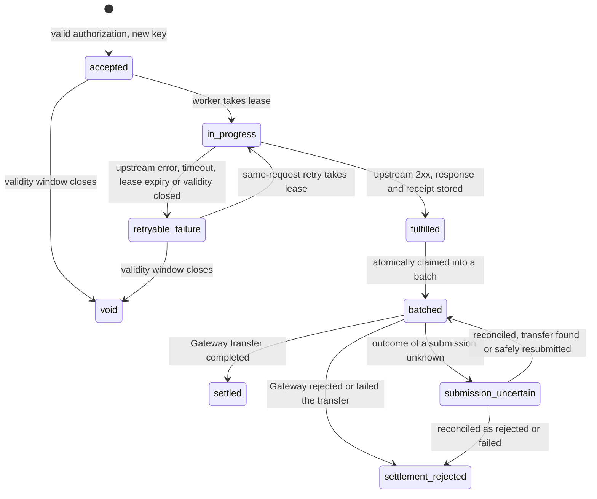

# Feature 1: x402 pay-per-request access (Arc, Circle Gateway, USDC)

Status: committed scope; specification only

Official kickoff on 5 Nov 2026; implementation is event work after the start tag.

## Goal
Let any client, human or AI agent, pay per request for World Chain data in USDC, with no account or API key.

## Design
- An offchain TypeScript x402 seller service, created with Arc Studio (studio.arc.io), sits in front of the existing Go API. The service connects to Arc Testnet for USDC payments through Circle Gateway. It is not an onchain program and is not "deployed on" Arc; where it is hosted is chosen at implementation.
- The Go API and `cmd/rpc-gateway` are unchanged. The seller service calls the Go API over HTTP with one server-side API key held in its environment, and calls no other application-data upstream. Circle Gateway remains the payment service: the seller calls its `settle()` to submit a payment authorization and its transfer lookup to observe the result. Gateway carries no application data.
- **Circle's documented sequence (re-read 2026-10-27; quotes in the table below)** is: the seller submits the signed authorization; Gateway verifies it, locks the buyer's funds and queues it for batch processing; the seller serves the resource immediately, without waiting for onchain settlement; Gateway, not the seller, later performs the batch and the onchain settlement. This spec follows that order: **the seller submits through `settle()` before upstream fulfillment**, never after it.
- **Seller flow for an ordinary open paid route:**
  1. A client requests a paid `/v1` route with no payment. The seller responds `402 Payment Required` with machine-readable payment requirements: price, asset (USDC), network (Arc Testnet) and `payTo` address.
  2. The client signs a USDC payment authorization (Circle Gateway nanopayments) and retries the request with the payment header.
  3. **Validate before settle.** The seller validates the request shape (method, body, path, query and the fingerprint rules below, and for an ENS name the resolution preflight) and the payment's structure (required fields, a 32-byte nonce, and network, asset, `payTo` and amount equal to the price table). Any failure is refused with a `4xx` or `503` before any ledger row exists and before any Gateway call, so it is never charged.
  4. **Reserve.** The seller inserts the ledger row for the `auth_key` in one atomic write with payment state `submission_pending` and fulfillment state `not_started`.
  5. **Submit.** The seller calls Gateway `settle()` with the signed authorization. A successful `settle()` means Gateway accepted the authorization: it verified it, locked the buyer's funds and queued it for batch processing. It does **not** mean the batch has been submitted or has settled onchain.
  6. **Fulfill.** Only after acceptance is known, the seller calls the Go API under a lease, stores the response and a receipt, and returns the response at once. It does not wait for Gateway's batch or for onchain settlement.
  7. **Later, by Gateway.** Gateway batches the accepted transfer with others and settles onchain on its own schedule. The seller does not create, claim, group or submit any batch. It observes the outcome only by transfer reconciliation (lookup by nonce; see Gateway batching and reconciliation).
- A definite `settle()` rejection is never fulfilled. A submission with an unknown outcome is reconciled by nonce before anything else happens (see the state model).
- A per-payer rate limit stops one funded wallet from flooding the Go API.
- Per-route price table: path to price in USDC atomic base units (an integer string; USDC has 6 decimals, so one cent is `10000`). No floating-point amount is used anywhere in the specs or the ledger. The human-readable form is derived by integer arithmetic for display only.
- The committed paid read flow is `GET` with an empty body. Other methods and bodies are outside it (see Request fingerprint).
- Per-request onchain settlement is not claimed. **Four events are separate and each needs its own evidence:** (1) Gateway accepts the authorization (`settle()` succeeds), (2) the seller fulfills the request upstream, (3) Gateway batches the transfer (observed through transfer status), and (4) the transfer is `completed` (final settlement). A successful response to the client proves only events 1 and 2.
- The demo has a public URL.
- The frontend is a web UI built with Arc Studio, and the backend is the seller service. A client uses the web UI to request a paid route, sign the payment authorization and see the fulfilled response and receipt. The one-command CLI demo client is a supplemental test utility, not the sole frontend.

## Authorization key
The ledger needs one stable identifier per payment authorization. The identifier is chosen from what Circle's documentation says about the nonce (all pages read on 2026-10-27):

| Source | What it says |
|---|---|
| [Sign EIP-3009 payment authorizations](https://developers.circle.com/gateway-nanopayments/howtos/eip-3009-signing) | The `nonce` is "a unique random 32-byte value for every payment"; reusing one is rejected. The EIP-712 domain is `GatewayWalletBatched` with the chain ID and the Gateway Wallet address (`verifyingContract`). `validBefore` must be at least 3 days ahead, or the authorization is rejected as `authorization_validity_too_short`. |
| [Gateway Nanopayments SDK reference](https://developers.circle.com/sdks/gateway-nanopayments-sdk) | `BatchFacilitatorClient.settle(payload, requirements)`: "Submits a payment for batched settlement through the Gateway API." Its `SettleResponse` is `{ success, errorReason?, payer?, transaction }`. Error `nonce_already_used`: "Payment nonce was already submitted". `TransferStatus` is `"received" \| "batched" \| "confirmed" \| "completed" \| "failed"`. `searchTransfers` can filter by `nonce` and by default searches the client's own network; `getTransferById` takes the transfer UUID. `unexpected_error`: "Infrastructure error (HTTP 500)". `Circle Gateway settle returned empty response ({status})` is a documented client error. |
| [Reconcile nanopayments as a seller](https://developers.circle.com/gateway-nanopayments/howtos/x402-seller-reconciliation) | "a completed request on your server confirms only that the payment was accepted, not that it settled". "nonce is unique per payment, so this returns at most one transfer". "Wait for `confirmed` before crediting the payer for accounting purposes and `completed` before initiating any dependent onchain operation. Transfers that end in `failed` were never charged. Do not fulfill the resource in that case." |
| [How batched settlement works](https://developers.circle.com/gateway-nanopayments/concepts/batched-settlement) | Step 4: "The seller (or a facilitator) submits the signed authorization to Gateway. Gateway verifies the signature, locks the buyer's funds, and credits the seller's pending balance. The seller serves the resource immediately, without waiting for onchain settlement." Step 5: "Gateway periodically collects pending authorizations, computes net balance changes across all participants, and submits a single onchain transaction that applies the changes. After onchain confirmation, pending balances become available." |
| [Settle an x402 payment](https://developers.circle.com/api-reference/gateway/all/settle-x402payment) | "Settles an x402 payment by submitting the EIP-3009 authorization. The authorization will be verified, the sender's balance locked, and the transaction queued for batch processing." Outcome is the `success` field of an HTTP 200 body; `transaction` is a UUID on success and an empty string on failure; HTTP 400 is an invalid or malformed request and HTTP 500 is `unexpected_error`. `errorReason` is one of `unsupported_scheme`, `unsupported_network`, `unsupported_asset`, `invalid_payload`, `address_mismatch`, `amount_mismatch`, `invalid_signature`, `authorization_not_yet_valid`, `authorization_expired`, `authorization_validity_too_short`, `self_transfer`, `insufficient_balance`, `nonce_already_used`, `unsupported_domain` or `wallet_not_found`. |
| [EIP-3009](https://eips.ethereum.org/EIPS/eip-3009) | In the base standard, a used nonce is tracked per authorizer: `authorizationState(authorizer, nonce)`. |

**What is not stated:** Circle's pages say the nonce is unique per payment but do not say whether uniqueness is per payer, per chain or global inside Gateway. The base EIP-3009 standard scopes it to the payer on the token contract. This is **to be confirmed against official docs at implementation**.

**Decision (conservative):**
- The stable **authorization key** is the composite `auth_key = <network>|<payer>|<nonce>`: the network exactly as in the accepted payment requirements, the payer address in lowercase `0x` hex, and the nonce as lowercase `0x` plus 64 hex characters, joined by `|`. It is the ledger's primary key and the identifier other components use, so it makes no assumption about Gateway's scope.
- The ledger also keeps a `UNIQUE` index on `nonce` alone. A nonce that is already present under a different payer or network is therefore refused (see the binding rules below) before it reaches `settle()`, instead of being treated as a new authorization that Gateway would reject as `nonce_already_used`.
- If Circle confirms per-payer or per-chain scope, relaxing the `nonce` index is a spec amendment, not a silent change.
- A nonce that is not exactly 32 bytes is refused as invalid.

## Request fingerprint
There is exactly one fingerprint algorithm, version `v1`. The seller, the ledger and the Agent Pass operation record in [04](04-agent-pass.md) all compute it with the same function, and the same vectors below are tests in each.

**Scope.** The committed paid read flow is `GET` with an empty body, which fits every route the initial scope uses (`/v1/balance`, `/v1/transactions` and the other read routes in `docs/openapi.yaml` are `GET`). A paid route that takes a request body (for example `POST /v1/auth/keys`) is outside the committed flow. Adding one needs a spec amendment that defines body hashing and a new fingerprint version.

**Rules.**
1. Inputs are the method, the raw request path and the raw query string. Headers (including the payment header and the seller's server-side API key), cookies and the URL fragment are not inputs.
2. **Method:** only `GET`. Any other method on a paid route is refused with `405`, before any fingerprint is computed.
3. **Body:** the request must carry zero body bytes. Any body, even on `GET`, is refused with `400`.
4. **Path:** the raw path must equal a route string in the price table byte for byte, otherwise `404` (no `402` challenge). Nothing is decoded or normalized, so a path with `%`, `//`, a dot segment, a trailing `/` or a different letter case matches no route.
5. **Query parsing:** the raw query is the text after the first `?`; a missing query and an empty query are the same (empty). It must be ASCII with no space, control character or `#`, else `400`. Split on `&`. An empty segment (`a=1&&b=2`, a leading or trailing `&`) is `400`. Split each segment at its first `=`; a segment with no `=`, or with an empty name, is `400`.
6. **Decoding:** percent-decode each name and each value exactly once. `%` must be followed by two hex digits in either case, else `400`. `+` is a literal plus sign, not a space. The decoded bytes must be valid UTF-8, else `400`. No Unicode normalization and no case folding is applied, including to hex addresses.
7. **Names:** every name must be a documented parameter of that route in `docs/openapi.yaml`, else `400`. A name that appears twice after decoding is `400`; duplicates are never merged or reordered.
8. **Encoding:** re-encode each decoded name and value from its UTF-8 bytes. The characters `A-Z a-z 0-9 - . _ ~` stay as they are; every other byte becomes `%XX` with uppercase hex digits. An empty value stays empty (`limit=` is kept, not dropped).
9. **Order:** sort the pairs by the encoded name, comparing bytes, ascending. Join them as `name=value` with `&`, with no leading `?`. No pairs gives an empty string.
10. **Canonical string:** five lines joined by a single line feed (`0x0A`) with no trailing line feed: the label `supersonic-x402-fp-v1`; the method; the path; the canonical query (an empty line when there is none); the literal `body:empty`. A line feed never occurs inside a component (rule 8 encodes one in a value as `%0A`; a method or path cannot contain one), so no component can be shifted across a boundary.
11. **Fingerprint:** SHA-256 of the UTF-8 bytes of the canonical string, written as 64 lowercase hex characters.
12. Any change to these rules gets a new version label. Fingerprints of different versions are never compared.

**Test vectors.** The hashes were computed with a standard SHA-256 tool over the exact canonical string, for example:

```
printf 'supersonic-x402-fp-v1\nGET\n/v1/balance\naddress=0xd8dA6BF26964aF9D7eEd9e03E53415D37aA96045\nbody:empty' | sha256sum
```

| # | Raw request target | Canonical query (line 4) | SHA-256 |
|---|---|---|---|
| 1 | `/v1/balance?address=0xd8dA6BF26964aF9D7eEd9e03E53415D37aA96045` | `address=0xd8dA6BF26964aF9D7eEd9e03E53415D37aA96045` | `ba886fc0227c7de9fec80680d996b742ce885d36acd97586a5356cd5a8beec59` |
| 2 | `/v1/transactions?limit=10&address=0xd8dA6BF26964aF9D7eEd9e03E53415D37aA96045` (also `address=...&limit=10`, and `limit=%31%30`) | `address=0xd8dA6BF26964aF9D7eEd9e03E53415D37aA96045&limit=10` | `d3314b3faa2a2a11d83b5f514d1d1ec618962591f3dcc770eb2e1e22139ff950` |
| 3 | `/v1/transactions?address=0xd8dA6BF26964aF9D7eEd9e03E53415D37aA96045&limit=` (empty value kept) | `address=0xd8dA6BF26964aF9D7eEd9e03E53415D37aA96045&limit=` | `7a16783af6912cf6c09a03ae11ad4ad7171ef16eecd440a27f41273d006f10ca` |
| 4 | `/v1/block/latest` (also `/v1/block/latest?`) | empty line | `e8e05191f29720d69a7662f65ca8c0b9076e8dadfeb9eec249ef884c94f9f317` |
| 5 | `/v1/defi/events?type=a%20b` | `type=a%20b` | `04d6ea2c43828ae69a7f7bf04d7430a9a53e785a3f9fb1eadabf2fd0ec18c183` |
| 6 | `/v1/defi/events?type=a+b` (also `type=a%2bb`) | `type=a%2Bb` | `e3ab72ae336a01e60dafcc38094db160bc37f27a93720962fb429bd7d7651acf` |
| 7 | `/v1/defi/events?type=a%0ab` (a line feed stays encoded) | `type=a%0Ab` | `1a373336c7664e4e6f9a3e5940ce276b61420547766db6c9f973ceb1fa9beace` |
| 8 | `/v1/defi/events?type=%c3%a9` | `type=%C3%A9` | `4a5d45e031dd0ccc18eeaa6fd7972502cdda7d4432aa88598369cd7e452a8def` |
| 9 | `/v1/balance?address=0xd8da6bf26964af9d7eed9e03e53415d37aa96045` (lowercase address: a different request from vector 1) | `address=0xd8da6bf26964af9d7eed9e03e53415d37aa96045` | `6acd3e7a7953ad7ded8fa951d93e494a3e4c1976a6d8750f095bb218da39bc31` |

Vectors 5 and 6 differ on purpose: a space and a plus sign are different values. Vectors 1 and 9 differ on purpose: the fingerprint does no address case folding.

**Rejection vectors** (no fingerprint is produced, no `402` challenge, no upstream call):

| # | Request | Result |
|---|---|---|
| R1 | `GET /v1/transactions?limit=1&limit=2` | `400` duplicate name |
| R2 | `GET /v1/transactions?address=0xd8dA6BF26964aF9D7eEd9e03E53415D37aA96045&&limit=1` | `400` empty segment |
| R3 | `GET /v1/transactions?limit` | `400` segment without `=` |
| R4 | `GET /v1/defi/events?type=%zz` | `400` bad percent escape |
| R5 | `GET /v1/defi/events?type=%FF` | `400` not valid UTF-8 |
| R6 | `GET /v1/balance/?address=0xd8dA6BF26964aF9D7eEd9e03E53415D37aA96045` | `404` no route matches the path |
| R7 | `GET /v1/balance?address=0xd8dA6BF26964aF9D7eEd9e03E53415D37aA96045&x=1` | `400` undocumented parameter |
| R8 | `GET /v1/balance?address=0xd8dA6BF26964aF9D7eEd9e03E53415D37aA96045` with a one-byte body | `400` body not empty |
| R9 | `POST /v1/balance` | `405` method outside the committed paid flow |

## ENS names and the fingerprint
Ordinary ENS support ([03](03-ens-integration.md)) stays on `/v1/balance` and `/v1/transactions`. **Decision:** for a paid request on those routes, the fingerprint covers the ENS name exactly as the client supplied it, in its canonical-query form. It does not cover the address the name resolves to.

- The fingerprint is computed before any resolution and is the same on every retry.
- What the payer authorized is therefore fixed by the request they signed for, and cannot be changed by a later change to the name's mutable ENS records.
- Names are compared as received. `Vitalik.eth` and `vitalik.eth` are different requests with different fingerprints, and no ENS normalization is applied inside the fingerprint (vectors 10 and 11). Any normalization of the name happens in the Go API after payment acceptance and does not alter the stored fingerprint.
- The resolved address, with the time and block of resolution, is recorded next to the stored response and receipt and returned in the response next to the supplied name, as in spec 03. Once the authorization is `fulfilled`, a retry returns the stored response unchanged, even if the name resolves differently later.
- The same payment authorization for a different name that happens to resolve to the same address is a different request: the nonce is refused with `409` (`authorization_binding_mismatch`).
- A `404` (name does not resolve) or `400` (malformed name) from the Go API is an upstream error. It is returned to the client, nothing is stored as a fulfilled response, and the authorization is not charged and stays under the retry and void rules above.
- Switching to a resolved-address fingerprint later is a spec amendment with a new fingerprint version.
- Agent Pass operations do not use ENS names: they accept literal addresses only (see [04](04-agent-pass.md)).

| # | Raw request target | Canonical query (line 4) | SHA-256 |
|---|---|---|---|
| 10 | `/v1/balance?address=vitalik.eth` | `address=vitalik.eth` | `36407a0aefb250af55ad8cd129236a8b87d9a19481733d76951522fa1f2f4d0d` |
| 11 | `/v1/balance?address=Vitalik.eth` | `address=Vitalik.eth` | `07d110ae01fb259a82cba9acdad88f147257aba96f0e154370476ebc1580e39e` |

## Ledger and authorization binding
The ledger has one row per authorization key. The insert of a new key is atomic, so concurrent first arrivals produce one row. Each row holds the **authorization binding**, written once at insert and never changed:

| Field | Meaning |
|---|---|
| `auth_key`, `nonce` | The composite key above, and the nonce alone (also unique) |
| `network`, `asset`, `pay_to`, `price` | As signed and as required by the price table: network, USDC token address, seller `payTo` address, amount in base units |
| `payer` | The `from` address of the authorization |
| `valid_after`, `valid_before` | The signed validity window |
| `fingerprint` | The `v1` fingerprint of the request the authorization was accepted for |

The row also holds the mutable state fields (payment state, Gateway status and fulfillment state, defined below), the submission attempt counter and timestamps, the lease owner and expiry, the stored response and receipt once fulfilled, the Gateway fields (`gateway_transfer_id`, taken from the `transaction` value that `settle()` returns, `gateway_status`, `gateway_error`) and the stored payment payload that submission needs. The payload is never logged or returned to a client. There is no seller `batch_id`: the seller does not form batches.

**Binding rule.** A request whose nonce is already in the ledger is a retry of the same authorization only if its payer, network, asset, `payTo`, price, validity window and fingerprint all equal the stored binding. If any one differs, the request is refused with `409` and the code `authorization_binding_mismatch`, in every state. There is no Gateway call, no upstream call, no state change and no charge. A request that matches a stored binding is served from the ledger and is not verified with Circle Gateway again, because Circle rejects a resubmitted nonce.

## Authorization and fulfillment state machine
A recorded nonce is not a consumed nonce. The ledger tracks how far a request got, so a lost upstream response never turns a retry into an "already used" rejection.



**Charge wording.** Fulfillment eligibility and settlement are different things, and only the second is a charge.
- *Fulfillment-eligible* means the state is `fulfilled`: exactly one logical response was delivered, so the authorization may be settled once. It is not yet a charge.
- *Charged* means `settled`: the Gateway transfer for this authorization has completed. Until then nothing is claimed as charged. Circle's own guidance is that a completed request on the seller confirms only that the payment was accepted.
- Wherever this spec or the evidence log says "one charge", it means one fulfillment-eligible authorization and at most one settlement.

| State | Meaning | Charge status |
|---|---|---|
| accepted | Authorization verified with Circle Gateway and recorded; no upstream call yet | Not charged |
| `in_progress` | One worker holds a lease and is calling the Go API | Not charged |
| fulfilled | Upstream response stored with a receipt | Fulfillment-eligible, once; not yet settled |
| `retryable_failure` | The upstream call failed, timed out, lost its lease or ran out of validity; the response is not stored | Not charged |
| batched | Claimed into one settlement batch (see Settlement batches); submitted or waiting to be submitted | Not yet settled |
| `submission_uncertain` | A submission to Circle Gateway has an unknown outcome and is being reconciled | Not yet settled |
| settled | The Gateway transfer for this authorization has completed | Charged, once |
| `settlement_rejected` | Gateway rejected the submission or the transfer failed; a failed transfer is never charged | Not charged; flagged as fulfilled but unpaid |
| void | The validity window closed before fulfillment, or the authorization was cancelled before fulfillment | Not charged; terminal |

| From | To | Trigger |
|---|---|---|
| none | accepted | Valid authorization with a key and nonce not in the ledger |
| accepted | `in_progress` | A worker takes the lease with a compare-and-set (and, for an Agent-Pass-protected route, the reservation check in the composition contract) |
| `in_progress` | fulfilled | Go API returns success; response and receipt stored in one transaction, while the validity window is still open |
| `in_progress` | `retryable_failure` | Go API error or timeout, the lease expires without a stored response, or the validity window closes before the commit |
| `retryable_failure` | `in_progress` | A request with the same binding takes the lease |
| fulfilled | batched | The settlement job claims it (see below) |
| batched | settled | The Gateway transfer reports `completed` |
| batched | `settlement_rejected` | A definite Gateway rejection, or the transfer reports `failed` |
| batched | `submission_uncertain` | A submission times out, drops, or returns an indeterminate answer |
| `submission_uncertain` | batched | Reconciliation finds the Gateway transfer, or finds a definite absence and resubmits once, as described below |
| `submission_uncertain` | `settlement_rejected` | Reconciliation shows a rejected or failed transfer, or the authorization expired without ever being submitted |
| accepted, `retryable_failure` | void | The validity window closes, or the authorization is cancelled before fulfillment |

Rules for a request that carries a nonce already in the ledger. The binding rule above applies first; the table covers requests with the same binding:

| State | Result |
|---|---|
| fulfilled, batched, `submission_uncertain`, settled, `settlement_rejected` | Return the stored response and receipt. No upstream call, no new Gateway call, no second charge, and no change to settlement. |
| accepted or `retryable_failure` | Take the lease, call the Go API and fulfill. One fulfillment in total. |
| `in_progress` | Wait for the lease holder and return its stored response; if the lease expires first, take it over as for `retryable_failure`. One logical fulfilled response and at most one settlement. Upstream reads are idempotent and may be repeated after a lease takeover, but duplicate upstream reads must never produce multiple fulfillments, charges or settlements. |
| void | Terminal. The request is refused with `409` and the code `authorization_void`; it is never fulfilled or settled. The client signs a new authorization with a new nonce. |
| a different binding in any state | `409` `authorization_binding_mismatch`. No upstream call, no state change, no charge. |

**Lease fencing:** fulfillment is committed with a conditional write that checks both the key and the current lease owner. A worker that no longer holds a valid lease must not store or directly return its upstream result as the fulfilled response. It discards that result and either returns the current stored result or instructs the client to retry. Every successful caller for the same key and binding receives the same stored response and receipt.

## Gateway batching and reconciliation
Gateway, not the seller, collects accepted authorizations, batches them and submits the onchain transaction. The seller never creates, claims, groups or submits a batch, and the ledger holds no batch identifier of its own. The seller only observes: it looks up the transfer for each accepted authorization and records what Gateway reports.

- **Lookup.** By transfer UUID (`getTransferById`) when the `transaction` value from `settle()` is stored, otherwise by `nonce` through the transfer search, with the sending network passed explicitly (the search defaults to the client's own network) and with `from`, `to`, amount and nonce compared to the stored binding. A transfer is adopted only if its sender, recipient, amount and nonce equal the stored binding. How `amount` is represented in a transfer record (decimal or base units) and whether `transaction` equals the transfer `id` are **to be confirmed against official docs at implementation**.
- **Gateway status mapping.** `gateway_status` only moves forward and is never inferred, only copied from a lookup:

| Gateway status | Meaning for this ledger | Locally settled? |
|---|---|---|
| (none yet) | `settle()` succeeded and no lookup has run | No |
| `received` | Gateway has the accepted transfer | No |
| `batched` | Gateway has put it in a batch | No |
| `confirmed` | The batch is confirmed onchain per Gateway | No (see below) |
| `completed` | Final settlement | **Yes, the only settled state** |
| `failed` | The transfer failed; Circle says such transfers "were never charged" | No; a payment failure (see below) |

  Only `completed` counts as locally settled. This is stricter than Circle's seller how-to, which says to wait for `confirmed` before crediting the payer for accounting purposes and for `completed` before a dependent onchain operation. Nothing in this project credits an account or runs a dependent onchain operation, so the stricter reading costs nothing, and promoting `confirmed` is a spec amendment. A status that moves backwards or is not in the list is recorded as an anomaly and never changes the stored state.
- **When lookups run.** Right after acceptance is not required (acceptance is the `settle()` success). A lookup runs: before each retry of a failed fulfillment; during reconciliation of an uncertain submission; and periodically for every accepted row that is not `completed` or `failed`. The period is chosen at implementation.
- **Failed transfer.** If the status is `failed` and the row is not yet fulfilled (`not_started` or `retryable_failure`), the seller does **not** fulfill: the row is closed as a payment failure, not retried and the client gets `402` with the code `payment_failed`. If the row is already fulfilled, the stored response is preserved and the row is flagged `fulfilled_but_unpaid` (see the state model). It is never blindly resubmitted and never recorded as not fulfilled.
- **Evidence.** Acceptance, fulfillment, `batched`/`confirmed` and `completed` are four separate evidence events (see Design).

## Composition with Agent Pass (spec 04)
This section is the seller's half of the contract; [04](04-agent-pass.md) holds the application's half (the `payment_binding` record, the execution transaction and cancellation). Both halves describe the same rules.

- **Route classes.** Every price-table entry is either `open` (payment is enough, as above) or `agent_pass` (payment is not enough). A route is never both. A paid operation that Agent Pass protects targets only an `agent_pass` route, so presenting payment through an `open` entry cannot stand in for the checkpoint. Which routes are `agent_pass` is chosen at implementation; the initial Agent Pass flow uses literal-address `GET` requests only.
- **Payment alone never fulfills a protected route.** The seller verifies and records a payment for an `agent_pass` route as usual (state `accepted`), but it does not take the lease. It answers `403` with the code `agent_pass_reservation_required` and the `auth_key`. Nothing is fulfilled, nothing is fulfillment-eligible, and the authorization can never enter a settlement batch.
- **Reservation check.** The `accepted` or `retryable_failure` to `in_progress` transition for such a row is one conditional write that also requires: a `payment_binding` row for this `auth_key` in state `reserved`; the bound `pending_operation` in state `executing`; and the operation's fingerprint, price, network, asset and `payTo`, and the binding's payer, equal to the ledger binding. The seller reads only application state (operation ID, state, fingerprint, price). **No World ID token, authorization code or claim is sent to or read by the seller**, and none is forwarded downstream.
- **One transaction boundary.** The conditional write above, the execution transaction in 04 and the cancellation in 04 must be able to commit atomically against one another, so the ledger and the Agent Pass tables share one transactional store. If an implementation cannot meet this, the composition is not implemented as specified and this spec is amended first.
- **Fulfillment commit.** When the ledger moves to `fulfilled`, the `payment_binding` moves to `fulfilled` and the operation to `executed` in the same transaction.
- **Void after reservation.** If the validity window closes after the reservation but before fulfillment, the ledger row moves to `void`, the binding to `void`, and the operation to `rejected` (reason `payment_void`). It is never fulfilled or settled. A new proposal, a new approval and a new authorization are required.
- **Cancellation before the reservation commits.** The operation is `cancelled`, and no binding can ever be created for it. If the cancellation names a held `auth_key`, the same transaction moves that row from `accepted` to `void`, conditional on no binding existing. If it does not, the unbound authorization still cannot be fulfilled and reaches `void` when its validity closes. Cancellation after the reservation has committed is refused (04), and the ledger then follows the normal lease and fulfillment rules.
- **Retries.** Idempotent upstream reads may repeat under lease fencing, as above. Across the whole composition there is at most one approval consumption, one binding, one logical fulfilled response, one fulfillment-eligible authorization and one settlement. A mutating upstream call is outside the committed flow; if one is ever added, an uncertain outcome of it is never retried blindly.
- **Settlement is separate.** `executed` means fulfilled, not settled. Settlement follows the batch rules above and is never claimed from the Agent Pass side.

## Paid-route enforcement
A route represented as paid is reachable only through the seller. Direct access to the Go API on `:8081` and any other proxy path to the same route is closed to the public network, or the route is a deliberately different free tier that the README and this spec document. The evidence is an external probe from outside the host.

## Done means
1. A request to a paid `/v1` route without payment returns HTTP 402 with machine-readable payment requirements.
2. The client retries with a signed payment authorization; the seller verifies it and fulfills the request; fulfilled authorizations are later settled in batch through Circle Gateway on Arc.
3. The Arc Studio project, created with Arc Studio, is the starting point of the seller service.
4. A request with an invalid authorization is not fulfilled and does not reach the Go API.
5. State machine tests cover:
   - Retry after a lost response: the upstream call completes, the response is lost before it is stored, and the retry with the same nonce and fingerprint is fulfilled with one fulfillment and at most one settlement.
   - Concurrent same-request retries, when no lease failure occurs: parallel requests with one nonce and fingerprint produce one upstream call, one fulfillment, at most one settlement and the same response for every caller.
   - Lease takeover failover: the first worker loses its lease while its upstream read is still running and a second worker takes over. A repeated upstream read is allowed. The test requires one stored result, one fulfillment and at most one settlement, and fails on a second fulfillment or settlement. The stale worker's late completion cannot overwrite the stored result or produce a second successful response. Concurrent and failover callers receive the same stored response and receipt, with one fulfillment and at most one settlement.
   - Nonce reuse with a different binding: the same nonce with a different fingerprint, payer, price, asset, network or `payTo` is rejected with `409` (`authorization_binding_mismatch`), one case per field, and none reaches the Go API or Circle Gateway.
   - Retry of a fulfilled, batched or settled authorization with the same binding returns the stored response and receipt with no upstream call, no Gateway call and no second charge.
   - A voided authorization is never fulfilled or settled, and a same-binding retry of a void authorization is refused with `409` (`authorization_void`).
6. Bypass evidence: an external probe from outside the host, with its output recorded in the evidence, shows direct access to `:8081` and any other proxy path to a paid route is refused or closed; or the route is a documented free tier.
7. The Arc Studio-built web UI performs the full flow end to end against the seller service. A demo client script also performs the full flow in one command as a supplemental test utility.
8. Open-source code, README section and a live demo URL.
9. Arc evidence is recorded in the README and the evidence log:
   - The Arc Studio URL (studio.arc.io) of the project.
   - Arc Studio shown in the demo.
   - An Arc Studio-built web frontend (web UI) and a backend (the seller service), both shown working together in the demo. The one-command CLI is a supplemental test utility and does not count as the frontend.
   - An architecture diagram of client, seller service, Circle Gateway, Go API and Arc.
   - Integration feedback on Arc Studio, Circle Gateway and Arc Testnet.
10. Fingerprint tests: every test vector (1 to 11) produces the listed canonical query and SHA-256, and every rejection vector (R1 to R9) produces the listed result and no `402` challenge.
11. Settlement batch tests:
    - Two settlement workers claim at the same time: each fulfilled authorization joins exactly one batch, with one `batch_id`, and no row is claimed twice.
    - A batch resumed after a crash keeps its `batch_id` and its members.
    - A member that Gateway rejects ends `settlement_rejected`, is never counted as settled or regrouped, and does not change the other members.
    - A submission whose response is lost ends `submission_uncertain` and is reconciled by a lookup on nonce; when the transfer exists there is no second submission. A resubmission happens only after a successful lookup that finds nothing.
    - `nonce_already_used` on a resubmission is treated as uncertain, not as a rejection.
12. The settlement-state mapping (`received`, `batched`, `confirmed`, `completed`, `failed` to ledger states) and the nonce scope are re-checked against Circle's current documentation at implementation, and any difference is recorded.
13. Agent Pass composition tests (spec 04 lists the full set): payment presented directly for an `agent_pass` route is never fulfilled; an authorization held without a reservation is never batched; a lease takeover on an `agent_pass` route passes the reservation check for both workers and still gives one fulfillment and at most one settlement; a void after reservation is never fulfilled or settled.
14. ENS fingerprint tests (PLANNED, ordinary routes only): the fingerprint of a request with an ENS name equals vectors 10 and 11 and is computed over the name, not the resolved address; two names that resolve to the same address have different fingerprints, and reusing one authorization's nonce for the other name is refused with `409`; a change in what the name resolves to between attempts changes neither the fingerprint nor an already stored response; an unresolvable name returns the upstream error without a fulfilled result or a charge.
