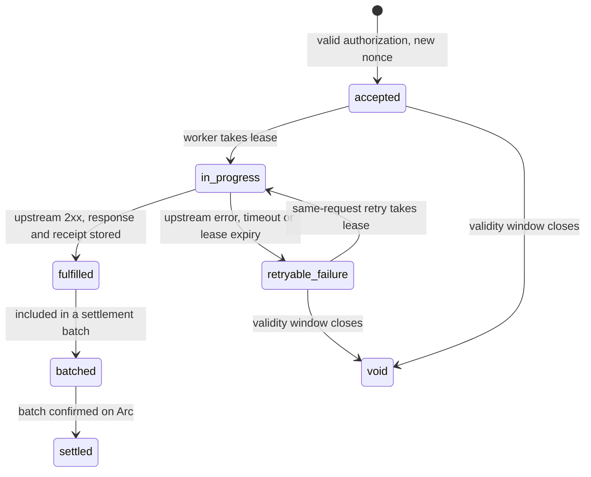

# Feature 1: x402 pay-per-request access (Arc, Circle Gateway, USDC)

Status: committed scope; specification only

Official kickoff on 5 Nov 2026; implementation is event work after the start tag.

## Goal
Let any client, human or AI agent, pay per request for World Chain data in USDC, with no account or API key.

## Design
- A TypeScript x402 seller service, created with Arc Studio (studio.arc.io) and deployed on Arc Testnet, sits in front of the existing Go API.
- The Go API and `cmd/rpc-gateway` are unchanged. The seller service calls the Go API over HTTP with one server-side API key held in its environment, and calls no other application-data upstream. Circle Gateway remains the payment service: the seller calls it to verify and settle payment authorizations, and it carries no application data.
- Seller flow:
  1. A client requests a paid `/v1` route with no payment. The seller responds `402 Payment Required` with machine-readable payment requirements: price, asset (USDC), network (Arc Testnet) and `payTo` address.
  2. The client signs a USDC payment authorization (Circle Gateway nanopayments) and retries the request with the payment header.
  3. The seller verifies the signed authorization with Circle Gateway, records it in the payments ledger and fulfills the request by calling the Go API, following the state machine below.
  4. Fulfilled authorizations are settled later in batch through Circle Gateway on Arc.
- A failed or rejected verification is never fulfilled.
- A per-payer rate limit stops one funded wallet from flooding the Go API.
- Per-route price table: path to price in USDC.
- Per-request onchain settlement is not claimed. The ledger separates an accepted authorization from a batch settlement that has reached Arc.
- The demo has a public URL.
- The frontend is a web UI built with Arc Studio, and the backend is the seller service. A client uses the web UI to request a paid route, sign the payment authorization and see the fulfilled response and receipt. The one-command CLI demo client is a supplemental test utility, not the sole frontend.

## Request fingerprint and ledger
The request fingerprint is a SHA-256 hash over the HTTP method, the route path, the canonicalized query string and the request body. The ledger has one row per authorization nonce, holding the fingerprint, the payer, the price, the state, the lease expiry, and, once fulfilled, the stored response and a receipt. The insert of a new nonce is atomic, so concurrent first arrivals produce one row.

## Authorization and fulfillment state machine
A recorded nonce is not a consumed nonce. The ledger tracks how far a request got, so a lost upstream response never turns a retry into an "already used" rejection.

| State | Meaning | Charged |
|---|---|---|
| accepted | Authorization verified with Circle Gateway and recorded; no upstream call yet | No |
| `in_progress` | One worker holds a lease and is calling the Go API | No |
| fulfilled | Upstream response stored with a receipt | Yes, once |
| `retryable_failure` | The upstream call failed, timed out or lost its lease; the response is not stored | No |
| settlement (batched, settled) | A fulfilled authorization is included in a batch (batched) and the batch is confirmed on Arc through Circle Gateway (settled) | Once, in one batch |
| void | The authorization's validity window closed before fulfillment; never settled | No |

| From | To | Trigger |
|---|---|---|
| none | accepted | Valid authorization with a nonce not in the ledger |
| accepted | `in_progress` | A worker takes the lease with a compare-and-set |
| `in_progress` | fulfilled | Go API returns success; response and receipt stored in one transaction |
| `in_progress` | `retryable_failure` | Go API error or timeout, or the lease expires without a stored response |
| `retryable_failure` | `in_progress` | A request with the same nonce and fingerprint takes the lease |
| fulfilled | batched | The settlement job adds the authorization to a batch |
| batched | settled | Circle Gateway confirms the batch on Arc |
| accepted, `retryable_failure` | void | The validity window closes |

Rules for a request that carries a nonce already in the ledger:

| Same nonce and... | State | Result |
|---|---|---|
| same fingerprint | fulfilled | Return the stored response and receipt. No upstream call, no second charge. |
| same fingerprint | accepted or `retryable_failure` | Take the lease, call the Go API and fulfill. One charge in total. |
| same fingerprint | `in_progress` | Wait for the lease holder and return its stored response; if the lease expires first, take it over as for `retryable_failure`. One logical fulfilled response and at most one settlement. Upstream reads are idempotent and may be repeated after a lease takeover, but duplicate upstream reads must never produce multiple charges or settlements. |
| different fingerprint | any | Reject with `409`. No upstream call, no state change, no charge. |

Only fulfilled authorizations enter a settlement batch. An authorization is settled at most once.

## Paid-route enforcement
A route represented as paid is reachable only through the seller. Direct access to the Go API on `:8081` and any other proxy path to the same route is closed to the public network, or the route is a deliberately different free tier that the README and this spec document. The evidence is an external probe from outside the host.

## Done means
1. A request to a paid `/v1` route without payment returns HTTP 402 with machine-readable payment requirements.
2. The client retries with a signed payment authorization; the seller verifies it and fulfills the request; fulfilled authorizations are later settled in batch through Circle Gateway on Arc.
3. The Arc Studio project, created with Arc Studio, is the starting point of the seller service.
4. A request with an invalid authorization is not fulfilled and does not reach the Go API.
5. State machine tests cover:
   - Retry after a lost response: the upstream call completes, the response is lost before it is stored, and the retry with the same nonce and fingerprint is fulfilled with one charge.
   - Concurrent same-request retries, when no lease failure occurs: parallel requests with one nonce and fingerprint produce one upstream call, one charge and the same response for every caller.
   - Lease takeover failover: the first worker loses its lease while its upstream read is still running and a second worker takes over. A repeated upstream read is allowed. The test requires one stored result, one charge and at most one settlement, and fails on a second charge or settlement.
   - Nonce reuse for a different request: the same nonce with a different fingerprint is rejected with `409` and does not reach the Go API.
   - Retry of a fulfilled request returns the stored response and receipt with no upstream call.
   - A voided authorization is never settled.
6. Bypass evidence: an external probe from outside the host, with its output recorded in the evidence, shows direct access to `:8081` and any other proxy path to a paid route is refused or closed; or the route is a documented free tier.
7. The Arc Studio-built web UI performs the full flow end to end against the seller service. A demo client script also performs the full flow in one command as a supplemental test utility.
8. Open-source code, README section and a live demo URL.
9. Arc evidence is recorded in the README and the evidence log:
   - The Arc Studio URL (studio.arc.io) of the project.
   - Arc Studio shown in the demo.
   - An Arc Studio-built web frontend (web UI) and a backend (the seller service), both shown working together in the demo. The one-command CLI is a supplemental test utility and does not count as the frontend.
   - An architecture diagram of client, seller service, Circle Gateway, Go API and Arc.
   - Integration feedback on Arc Studio, Circle Gateway and Arc Testnet.
