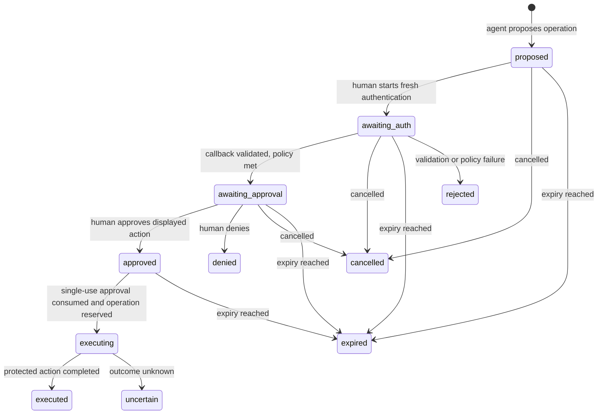

# Feature 4: World ID Agent Pass (human checkpoint for one paid or elevated data request)

Status: committed scope, third priority; specification only. Nothing in this document is implemented, run or verified against a live service.

Official kickoff on 5 Nov 2026; implementation is event work after the start tag.

## Scope order
1. Arc x402 ([01](01-x402-arc-gateway.md)): core priority.
2. World ID IDKit ([02](02-world-id-gating.md)): core priority.
3. World ID Agent Pass (this spec): third priority. It is attempted after the Arc and IDKit flows work end to end, with their demos, tests and evidence complete.
4. ENS name inputs ([03](03-ens-integration.md)): fourth priority, attempted after Agent Pass is complete and evidenced.

Uncommitted stretch options (not part of this scope order) are listed in [90-stretch-options.md](90-stretch-options.md).

## Goal
An agent proposes one paid or elevated Supersonic data request. The backend pauses the workflow and stores the exact pending operation. A human completes fresh World ID Agent Pass authentication and then separately approves or denies the displayed business action in our application. Only the approved operation may resume, and at most once. Agent Pass approval never replaces Arc/x402 payment.

## Official sources
All World ID claims in this document are taken from these pages, as read on 2026-10-27. They are the only basis for API and flow statements here. Anything they do not state is marked "to be confirmed against official docs at implementation". Re-read them before implementation; they may change.

- World ID Agent Pass docs: <https://auth.world.org/docs>
- Human in the loop guide: <https://auth.world.org/docs/guides/human-in-the-loop>
- Step-up authentication guide: <https://auth.world.org/docs/guides/step-up>
- ETHGlobal Mumbai World prizes page: <https://ethglobal.com/events/mumbai/prizes/world>

What the sources say that this design relies on:

| Topic | What the official pages state |
|---|---|
| Role of the issuer | The World ID issuer provides an authentication result over OpenID Connect. It does not receive, display or approve the pending business action. The ID token carries authentication context, not terms of a business operation or a signed action digest. Approval of the action is implemented and recorded by the application. |
| Identifier | The `sub` claim is a pairwise private identifier. The application stores the issuer and subject together, `(iss, sub)`, to recognize the same World ID account. A World ID added to an existing account is linked explicitly while the user is signed in to that account, before later checkpoints rely on it. |
| Fresh authentication, browser flow | `max_age=0` requires fresh authentication for the transaction even with an existing browser session. `prompt=login` also requires fresh authentication and overrides a larger `max_age`. A positive `max_age` permits reuse of recent authentication. `prompt=none` must not be combined with a freshness requirement. `select_account` and prompt combinations are rejected. |
| Fresh authentication, device flow | The device flow always requires fresh authentication but does not implement `max_age` or `prompt`, and its approval covers authentication for the requesting client, not a business action. |
| Request shape | Same registered client, `scope=openid`, state and S256 PKCE as browser authentication, at the authorization endpoint from the OIDC discovery document. The protocol permits omitting nonce; the step-up procedure uses it to bind the result to the attempt. |
| Assurance request | `acr_values` is a voluntary preference and unsupported values do not force an error, so the achieved `acr` must be validated. An essential `acr` in the `claims` parameter requires an acceptable class; if none is supported the request fails with `unmet_authentication_requirements`. Documented classes: `https://world.org/oidc/acr/orb` and `https://world.org/oidc/acr/orb-face` (Face Auth). |
| Result claims | `acr`, `amr` and `auth_time`. `amr` is `["pop"]` for a World ID proof, `["pop", "face"]` for Face Auth, and `["pop", "user", "mfa"]` for a user-verified passkey, which does not assert a fresh World proof. `auth_time` is the server verification time of the proof or passkey assertion; browser-session reuse preserves it, and a new token's `iat` does not imply a fresh proof. |
| `max_age=0` freshness check | The authentication must belong to the newly initiated attempt (start time, nonce, bounded lifetime). Its age need not stay literally zero during the browser round trip. The application enforces its allowed freshness window at execution time. |
| Single use and retries | Mark an approval used in the same database transaction that authorizes or reserves the operation. A cancellation blocks the operation only if saved first. Check expiry and revocation before each use. Give each external operation a stable ID; do not blindly retry; do not re-authenticate to repeat an uncertain operation. |
| Downstream credentials | Do not send the World ID ID token to a downstream MCP server. The backend issues and validates its own credentials. RFC 9470 challenge and retry is a response the application's own resource server implements, not a World ID issuer endpoint, and needs client and auth-server support. |
| Prizes page | See [Prize wording and eligibility](#prize-wording-and-eligibility). |

## Not interchangeable with IDKit
IDKit free-tier uniqueness ([spec 02](02-world-id-gating.md)) and Agent Pass action approval (this spec) are separate integrations and are not interchangeable.

- IDKit produces an action-scoped nullifier used to allow one active self-service free-tier key. Agent Pass produces an OIDC authentication result identified by the pairwise `(iss, sub)`.
- A nullifier is never treated as, compared with or derived from `(iss, sub)`, and the two are stored in different tables for different purposes.
- Holding an IDKit-minted key does not authorize an Agent Pass approval, and an Agent Pass authentication does not mint, rotate or recover a key.
- Each has its own evidence rows, its own demo steps and its own integration debrief. A claim for one is never used as evidence for the other.

## Design

### Components and reuse
- **Agent**: proposes the operation through a server endpoint using the agent's own application credential. It never holds a World ID token. The endpoint names in this document are illustrative names for our own application, not World ID endpoints.
- **Backend**: stores pending operations, runs the OIDC client directly against the World ID issuer (no intermediate auth server), validates results, records approvals and executes. The pending-operation tables live in the same kind of dedicated transactional store as spec 02. Whether they share that database file or the Arc ledger from spec 01 is decided at implementation; the constraint is that the approval consumption and the operation reservation commit in one transaction.
- **Frontend**: the approval journey reuses the event web frontend (the web UI that spec 01 defines for the Arc flow) as additional views. No separate unrelated UI is created.
- **Application session**: the human must hold an authenticated application session for the target account. The repository today has API keys and no user-session model, so the minimal account and session model required for the demo is defined at implementation. It must support linking a World ID `(iss, sub)` to an account while signed in.

### Journey


1. The agent proposes one operation. The backend computes the request fingerprint, stores the pending operation in state `proposed`, and returns an operation ID and an approval link. The protected action is not executed. The agent may poll the operation status; polling and retries never extend the expiry.
2. The human opens the link in the event web frontend and signs in to the application. The frontend shows the displayed action (see the approval UI below) and a control to start fresh authentication.
3. The backend creates an authentication attempt bound to the operation and session (see OIDC binding) and redirects to the World ID issuer.
4. The human completes World ID authentication. The browser returns to the backend callback, which validates the result. The operation moves to `awaiting_approval` only if every check passes.
5. The application shows the stored operation again and the human approves or denies it. The application records the decision.
6. The agent (or the human, through the frontend) resumes the operation. The backend rechecks everything, consumes the approval and reserves the operation in one transaction, then executes.

### Approval UI
The approval view is rendered only from the stored pending-operation row, never from values the agent supplies at approval time. It is shown after authentication has been validated and before any decision is recorded. The mock below uses placeholders, not real data.

```text
+------------------------------------------------------------------+
| Approve an agent request                                         |
| World ID authentication: validated for this attempt              |
+------------------------------------------------------------------+
| Agent              <agent display name> (<agent id>)             |
| Account            <account display name> (<account id>)         |
| Operation ID       <operation id>                                |
| Method and route   GET /v1/transactions                          |
| Query (canonical)  address=<shortened address>, limit=<n>        |
| Consequence        Paid request: <price from the route price     |
|                    table> USDC via x402 on Arc Testnet.          |
|                    Approving does NOT pay. Payment is a          |
|                    separate x402 authorization.                  |
|                    (or: Elevated access: <named access change>)  |
| Request fingerprint  sha256:<first 12 hex of the stored value>   |
| Expires            <expiry time and countdown>; not extended     |
|                                                                  |
|        [ Approve this exact request ]   [ Deny ]   [ Cancel ]    |
+------------------------------------------------------------------+
```

| Field | Source and rule |
|---|---|
| Agent and account | Stored agent identity and the target account bound at proposal. |
| Operation ID | Stable ID created at proposal. |
| Method and route | Stored values of the exact request. |
| Query summary | A rendering of the canonicalized query string stored with the operation. Long values are shortened for display; the full canonical string is kept server-side and is what the fingerprint covers. |
| Price or access consequence | For a paid route, the price copied from the spec 01 route price table at proposal time, shown with the asset and network. For an elevated request, a named access change. A price that changes after proposal makes the operation stale and requires a new approval. Not applicable consequences are omitted, not invented. |
| Request fingerprint | The SHA-256 fingerprint defined in spec 01 (method, route path, canonicalized query string, body), shown truncated. The approve control submits the operation ID and the full fingerprint; the server compares both with the stored row. The initial scope is requests with an empty body, so no request body is stored or displayed. |
| Expiry | The stored expiry. Checking status never extends it. |

Approve, deny and cancel are state-changing requests protected by the application session and an anti-CSRF token, and they are accepted only for the operation that is currently displayed for that session.

## Data model
Pending operations, authentication attempts and approvals are separate tables in the transactional store.

| Table | Columns | Constraints |
|---|---|---|
| `pending_operation` | `id` (stable operation ID), `agent_id`, `account_id`, `initiating_session` (server-side session identifier), `method`, `route`, `canonical_query`, `fingerprint`, `price_usdc` (nullable), `access_consequence` (nullable), `linked_iss` and `linked_sub` (nullable; the linked World ID where already linked), `enrollment_allowed` (boolean), `required_acr`, `required_amr`, `max_auth_age_seconds` (checked at execution), `state`, `created`, `expires` | The operation, account, fingerprint, price, assurance policy and expiry are written once at proposal and never updated; only `state` changes, and only through the transitions above. `expires` is never extended. |
| `auth_attempt` | `id`, `operation_id`, `session`, `state_hash`, `nonce_hash`, `pkce_verifier`, `started`, `expires`, `code_redeemed_at`, `result` (`pending`, `validated`, `failed`), `auth_time`, `acr`, `amr`, `iss`, `sub` | `state_hash` unique. At most one open attempt per operation; a new attempt supersedes the previous one. The PKCE verifier stays on the server and is cleared when the attempt closes. `iss` and `sub` are written only after every check passes. |
| `approval` | `id`, `operation_id`, `auth_attempt_id`, `account_id`, `decision` (`approved`, `denied`), `fingerprint_at_decision`, `decided`, `used_at` | A partial unique index allows at most one `approved` row per operation. `used_at` is set once, in the same transaction that reserves the operation. A denial or cancellation row blocks the operation. |
| `world_id_link` | `account_id`, `iss`, `sub`, `linked_at` | `UNIQUE(iss, sub)` and one link per account. Written only by an explicit link or enrollment flow while the human is signed in, and only after validation (see below). Separate from the IDKit `verification` table. |

The pending operation does not store the World ID ID token, authorization code or client credentials. The agent's application credential is stored or hashed under the same rules as spec 02 API keys.

## Authentication request
- The backend starts a new OIDC authorization request for each attempt. It never reuses a previous result, an existing browser session at the issuer, or an earlier attempt.
- The authorization endpoint, issuer value, token endpoint and signing keys come from the issuer's OIDC discovery document. The step-up guide names `https://auth.world.org/api/v1/authorize` as the authorize endpoint for forwarded requests; the other endpoints and the exact discovery URL are to be confirmed against official docs at implementation.
- Parameters: the standard authorization code flow parameters for the registered client, `scope=openid`, a fresh `state`, a fresh `nonce`, an S256 PKCE code challenge, and the assurance request described below.
- **Freshness: `max_age=0`.** The docs support both `max_age=0` and `prompt=login` for the browser flow. This design uses `max_age=0` and does not also send `prompt=login`; whether the two may be combined is not stated and is to be confirmed against official docs at implementation. `prompt=login` is the documented alternative if `max_age=0` proves unusable. `prompt=none` is never sent.
- **Assurance request.** The baseline required class is `https://world.org/oidc/acr/orb`, requested through an essential `acr` in the `claims` parameter (using the JSON shape the step-up guide shows for Face Auth, with the Orb class value). `acr_values` alone is not enough because it is voluntary. Face Auth (`orb-face`) is not required by default, because the minimum sufficient assurance for one paid or elevated read request is an Orb-class human; a policy that requires it is a per-operation setting. The exact claims JSON is to be confirmed against official docs at implementation.
- Device flow is not used, because it does not implement `max_age` or `prompt` and its approval covers authentication, not the action.

### OIDC binding to session and operation
- `state` is a fresh random value with at least 256 bits of entropy. Only its hash is stored in `auth_attempt`, keyed to `operation_id` and the initiating session.
- `nonce` is a fresh random value; its hash is stored with the attempt and compared with the ID token's `nonce`.
- The PKCE verifier is a fresh random value generated and kept on the server; only the S256 challenge is sent to the issuer. The verifier is sent only on the one code redemption.
- The callback is accepted only if it arrives in the same application session that started the attempt and the attempt's operation is still in `awaiting_auth`. State, nonce and verifier are never reused across operations.
- Redirect URI registration and any issuer-side rules about it are to be confirmed against official docs at implementation.

## Callback validation
The backend callback treats the result as untrusted until every step passes. Any failure ends the attempt as `failed`, leaves the operation unauthorized and executes nothing.

1. An error response from the issuer (for example a cancellation, `login_required`, `interaction_required`, `unmet_authentication_requirements` or `access_denied`) closes the attempt and the operation stays blocked. The exact set and shape of authorization error responses for a cancelled browser attempt is to be confirmed against official docs at implementation.
2. `state` matches a stored, open, unexpired attempt, and the callback comes from the initiating session and the target account.
3. The authorization code is redeemed once with the saved PKCE verifier and the registered client's authentication. A second redemption of the same attempt is refused locally. Client authentication method and credential handling are to be confirmed against official docs at implementation (the docs list RS256 `private_key_jwt` among supported client authentication standards).
4. ID token validation: RS256 signature against the issuer's published keys, `iss` equal to the expected issuer, `aud` containing this application's client ID, `exp` in the future (allowing only a small, explicit clock tolerance), implausibly future timestamps rejected, and `nonce` equal to the stored nonce.
5. Account and identity binding. If the account has a linked World ID, the returned `(iss, sub)` must equal the saved `linked_iss` and `linked_sub`. If the account is unlinked, continue only when the saved attempt has `enrollment_allowed` and the identity is not linked to another account. The pair is not stored yet.
6. Freshness and assurance against the saved policy (next section).
7. Only after all checks pass, in one transaction: save the `(iss, sub)` link if enrolling (only while the account is still unlinked and the identity is still unassigned), mark the attempt `validated`, and move the operation to `awaiting_approval`.

## Assurance policy: identity is not authorization
A valid identity alone is not authorization. After callback validation, the saved policy is applied to the returned claims.

- `acr` is checked against `required_acr`. A value that does not satisfy the policy is rejected, even if the token is otherwise valid, because `acr_values` is only a preference.
- `amr` is checked against `required_amr`. This design requires that `amr` contains `pop` (a World ID proof). A passkey-only result (`["pop", "user", "mfa"]` is documented as not asserting a fresh World proof) is rejected for this policy. Whether to accept a passkey is a policy choice recorded per operation.
- `auth_time` is checked for belonging to the newly initiated attempt (not earlier than the attempt start, within the attempt's bounded lifetime), and re-checked at execution time against `max_auth_age_seconds`. A new token's `iat` is never used as proof of freshness. Because `auth_time` is the server verification time of the proof, not the phone's proof time, it is treated as a bound, not an exact time. The proposed defaults (attempt lifetime 10 minutes, execution freshness window 5 minutes, clock tolerance 30 seconds) are design values for the demo, not values from official docs.
- The result establishes only that the matched human authenticated at this assurance. It does not decide whether that human may approve this operation: the application also checks the account's permission to approve it.

The World ID issuer authenticates the human. It does not approve our payment or our query, and nothing in the ID token states what was approved.

## Separate approval of the business action
After validation the application, not the issuer, collects and records the decision.

- The approval view (above) shows the stored operation and asks the human to approve or deny.
- The decision is recorded in `approval` against the account, the operation, the validated attempt and the displayed fingerprint (`fingerprint_at_decision`). Approve is accepted only while the operation is `awaiting_approval`, the attempt is validated and unexpired, and the posted fingerprint equals the stored fingerprint.
- Deny and cancel are recorded and block the operation. A cancellation blocks only if it is saved before execution; it cannot undo an executed operation.
- Agent Pass approval never replaces Arc/x402 payment. A paid operation still needs a valid x402 payment authorization under spec 01 for the same fingerprint and price, and approval is not payment, authorization of payment, fulfillment or settlement. Per-request onchain settlement is not claimed.

## Execution
Execution runs only after the agent or human resumes an `approved` operation. Immediately before execution the backend rechecks, and any failed check fails closed:

- the operation is `approved`, not expired and not cancelled, and expiry has not been extended;
- the approval is an unused `approved` row for this operation and is not superseded;
- the fingerprint recomputed from the actual request equals the stored and approved fingerprint, and the account, agent, price or access consequence equals the stored values;
- the application session or grant is still valid for the target account, the account has not been revoked, and the account still has permission to approve and run this operation;
- the linked `(iss, sub)` still equals the one validated for this operation, and the stored `acr`, `amr` and `auth_time` still satisfy the saved policy, with `auth_time` within `max_auth_age_seconds` now;
- for a paid operation, a valid x402 authorization exists under spec 01 for the same fingerprint and price.

**Atomic single use.** In one database transaction the backend sets `approval.used_at` with a conditional update that requires it to be unset, checks that exactly one row changed, moves the operation to `executing`, and authorizes or reserves the operation (for a paid operation, the reservation or ledger step defined by spec 01). If any statement fails or no row changed, the transaction rolls back and nothing executes. Two concurrent resumes produce exactly one reservation. The upstream call happens after the commit, with the stable operation ID.

**Stable IDs and uncertain outcomes.** The operation ID is the identifier for the protected action. After a timeout or lost response the backend asks the owning component (the ledger and the Go API result store from spec 01) whether the operation completed. It retries only under the same operation ID and only where that component guarantees a duplicate cannot run twice, never by consuming a second approval and never by asking the human to authenticate again. If the result cannot be determined, the operation stays `uncertain`, is not retried blindly, and is investigated.

**Changed binding.** A changed operation, route, query, price, account or fingerprint is a different operation and requires a new proposal and a new approval. A retried or extended attempt never carries an old approval forward.

**No token forwarding.** The World ID ID token and authorization code are never sent to the Go API, the seller service's downstream calls, any MCP server or any other API. Downstream calls use the application's own server-side credentials as defined in spec 01. The assurance result is conveyed only through server state.

## Fail-closed outcomes
Each case below leaves the protected action unexecuted. The operation ends in the state shown, or stays blocked.

| Case | Outcome |
|---|---|
| Human denies | `denied`; no execution |
| Human or issuer cancels | `cancelled`; no execution |
| Operation or attempt expires, including while awaiting approval or after approval but before execution | `expired`; no execution |
| Stale: price, access policy, account permission or freshness window no longer satisfied | rejected at the execution recheck; new approval required |
| Mismatched: state, nonce, issuer, audience, session, account or `(iss, sub)` | attempt `failed`; operation `rejected` or unchanged; no approval can be recorded |
| Assurance below policy (`acr`, `amr` or `auth_time`) | attempt `failed`; no approval can be recorded |
| Replayed callback, code, approval or resume request | refused; at most one execution |
| Changed fingerprint, route, query, price or account | refused; new proposal and new approval required |
| Dependency failure: issuer, discovery document, signing keys or token endpoint unreachable; store unavailable; payment dependency failing | operation stays blocked; nothing executes; no fallback to an unvalidated result |
| Uncertain outcome of an executed request | `uncertain`; no blind retry; no new authentication to repeat it |

## Logging and public evidence
- Never log or publish: client secrets or private keys, API keys, authorization codes, ID tokens, access tokens, the PKCE verifier, `state` or `nonce` values, request bodies, or sensitive query content.
- Logs and public evidence may contain: operation ID, state transitions, outcome codes, a truncated fingerprint, and timestamps.
- Public evidence uses synthetic, non-sensitive queries over public chain data, with any address shortened. A fingerprint is a hash and can confirm a guessed query, so evidence prefers a short prefix.
- `(iss, sub)` pairs are not published. Evidence of linking shows that a link exists, not its value.
- Credentials come from environment variables only, as in the README.

## Done means
Each item is demonstrated with real execution and recorded in [EVIDENCE.md](../../EVIDENCE.md); until then every row stays `PLANNED` or `NOT_YET_RUN`.
1. Complete successful journey: an agent proposes a paid or elevated request, the workflow is paused with the exact operation stored, fresh authentication with `max_age=0` is completed and validated by the backend, the human approves the displayed action in the application, the operation executes exactly once, and a paid request also completes its separate Arc/x402 payment under spec 01.
2. Denied journey: the human denies; the protected action does not occur and the operation stays blocked.
3. Expired or cancelled journey: an expired operation and a cancelled operation each remain blocked, including an attempt to resume after expiry and after cancellation.
4. Backend-validation failure: at least one injected failure (for example wrong `state`, wrong `nonce`, wrong audience, wrong `(iss, sub)` or a result below the `acr`, `amr` or `auth_time` policy) is rejected and executes nothing. An unvalidated client-side response is never accepted as authorization.
5. Changed-fingerprint rejection: changing the request after approval is refused and requires a new approval.
6. Replay and double-execution prevention: a replayed callback, code, approval or resume, and concurrent resumes, produce at most one execution.
7. Test coverage for the checks in Callback validation, Assurance policy, Execution and Fail-closed outcomes, including both acceptance and rejection cases.
8. Log and evidence review confirming no ID token, authorization code, secret, request body or sensitive query content appears in public logs or evidence.
9. The approval journey is a view of the event web frontend, not a separate unrelated UI.
10. Open-source code, README section and a live demo.
11. A World Agent Pass integration debrief (below), completed from real experience.

## World Agent Pass integration debrief
Status: PLANNED / NOT_YET_RUN. This is a template. Every field below stays empty or `NOT_YET_RUN` until the integration has actually been attempted. No experience is recorded here in advance.

The prizes page asks for a short debrief covering time to first success, friction encountered, missing capability or documentation, and the one improvement with the greatest impact. The headings below cover those and the use case and outcome headings this project also tracks.

| Heading | Content |
|---|---|
| Chosen use case | NOT_YET_RUN |
| Time to first success | NOT_YET_RUN |
| Integration friction | NOT_YET_RUN |
| Missing capability or documentation | NOT_YET_RUN |
| One high-impact improvement | NOT_YET_RUN |
| What we changed as a result | NOT_YET_RUN |

## Prize wording and eligibility
The ETHGlobal prizes page, as read on 2026-10-27, lists two prizes titled "World ID Agent Pass":

- one with the notice "This prize is only available to Continuity Track participants", and
- a second, general one without that notice.

The page does not name the first one "Continuity Agent Pass"; the Continuity-only notice is the page's wording. The page also lists separate IDKit prizes, so Agent Pass and IDKit are separate prize listings as well as separate integrations.

The qualification requirements on the page, as read, are: integrate with the official World ID Agent Pass; demonstrate the complete journey (identity or verification request, user completion, validated result, and the protected application or agent action); demonstrate a denied, expired, cancelled or otherwise unsuccessful path where the protected action does not occur; validate identity results in a secure backend without exposing client secrets or treating an unvalidated client response as authorization; and include a short integration debrief. The page also states for the general prize that proofs use fake identities and must not be relied on in production.

This document targets the Continuity-only listing. It claims no selection, eligibility or winnings. Final prize terms, whether the Continuity-only listing carries the same requirements as the general one, and whether a Continuity Track project may also be considered for the general one are to be rechecked against the official page at implementation and before submission.

## Items to be confirmed against official docs at implementation
- The OIDC discovery URL, issuer value, token endpoint, signing key location and supported client authentication methods.
- Client registration in the Agent Pass portal, redirect URI rules, and sector configuration for the pairwise `sub`.
- The exact `claims` JSON and `acr` value for the baseline Orb requirement.
- Whether `max_age=0` and `prompt=login` may be sent together.
- The shape of the error response for a human-cancelled or denied browser attempt.
- The exact set of claims and expiry semantics in the ID token (beyond `acr`, `amr`, `auth_time` and `sub` named in the docs).
- Behavior of mock proofs and fake identities noted on the prizes page, and how they affect what a demo can show about real human assurance.
- Any change to the four official pages since 2026-10-27.
