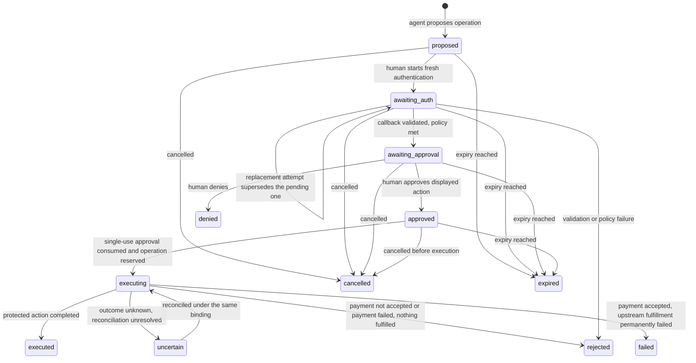

# Feature 4: World ID Agent Pass (human checkpoint for one paid or elevated data request)

Status: committed scope, third priority; specification only. Nothing in this document is implemented, run or verified against a live service.

Official kickoff on 5 Nov 2026; implementation is event work after the start tag.

## Scope order
1. Arc x402 ([01](01-x402-arc-gateway.md)): core priority.
2. World ID IDKit ([02](02-world-id-gating.md)): core priority.
3. World ID Agent Pass (this spec): third priority. It is attempted after the Arc and IDKit flows work end to end, with their demos, tests and evidence complete.
4. ENS name inputs ([03](03-ens-integration.md)): fourth priority, attempted after Agent Pass is complete and evidenced.

Uncommitted stretch options (not part of this scope order) are listed in [90-stretch-options.md](90-stretch-options.md).

## Goal
An agent proposes one paid or elevated Supersonic data request. The backend pauses the workflow and stores the exact pending operation. A human completes fresh World ID Agent Pass authentication and then separately approves or denies the displayed business action in our application. Only the approved operation may resume, and at most once. Agent Pass approval never replaces Arc/x402 payment.

## Official sources
All World ID claims in this document are taken from these pages, as read on 2026-10-27. They are the only basis for API and flow statements here. Anything they do not state is marked "to be confirmed against official docs at implementation". Re-read them before implementation; they may change.

- World ID Agent Pass docs: <https://auth.world.org/docs>
- Human in the loop guide: <https://auth.world.org/docs/guides/human-in-the-loop>
- Step-up authentication guide: <https://auth.world.org/docs/guides/step-up>
- ETHGlobal Mumbai World prizes page: <https://ethglobal.com/events/mumbai/prizes/world>

What the sources say that this design relies on:

| Topic | What the official pages state |
|---|---|
| Role of the issuer | The World ID issuer provides an authentication result over OpenID Connect. It does not receive, display or approve the pending business action. The ID token carries authentication context, not terms of a business operation or a signed action digest. Approval of the action is implemented and recorded by the application. |
| Identifier | The `sub` claim is a pairwise private identifier. The application stores the issuer and subject together, `(iss, sub)`, to recognize the same World ID account. A World ID added to an existing account is linked explicitly while the user is signed in to that account, before later checkpoints rely on it. |
| Fresh authentication, browser flow | `max_age=0` requires fresh authentication for the transaction even with an existing browser session. `prompt=login` also requires fresh authentication and overrides a larger `max_age`. A positive `max_age` permits reuse of recent authentication. `prompt=none` must not be combined with a freshness requirement. `select_account` and prompt combinations are rejected. |
| Fresh authentication, device flow | The device flow always requires fresh authentication but does not implement `max_age` or `prompt`, and its approval covers authentication for the requesting client, not a business action. |
| Request shape | Same registered client, `scope=openid`, state and S256 PKCE as browser authentication, at the authorization endpoint from the OIDC discovery document. The protocol permits omitting nonce; the step-up procedure uses it to bind the result to the attempt. |
| Assurance request | `acr_values` is a voluntary preference and unsupported values do not force an error, so the achieved `acr` must be validated. An essential `acr` in the `claims` parameter requires an acceptable class; if none is supported the request fails with `unmet_authentication_requirements`. Documented classes: `https://world.org/oidc/acr/orb` and `https://world.org/oidc/acr/orb-face` (Face Auth). |
| Result claims | `acr`, `amr` and `auth_time`. `amr` is `["pop"]` for a World ID proof, `["pop", "face"]` for Face Auth, and `["pop", "user", "mfa"]` for a user-verified passkey, which does not assert a fresh World proof. `auth_time` is the server verification time of the proof or passkey assertion; browser-session reuse preserves it, and a new token's `iat` does not imply a fresh proof. |
| `max_age=0` freshness check | The authentication must belong to the newly initiated attempt (start time, nonce, bounded lifetime). Its age need not stay literally zero during the browser round trip. The application enforces its allowed freshness window at execution time. |
| Single use and retries | Mark an approval used in the same database transaction that authorizes or reserves the operation. A cancellation blocks the operation only if it commits before the execution reservation; the two cannot both win (see Cancellation). Check expiry and revocation before each use. Give each external operation a stable ID; do not blindly retry; do not re-authenticate to repeat an uncertain operation. |
| Downstream credentials | Do not send the World ID ID token to a downstream MCP server. The backend issues and validates its own credentials. RFC 9470 challenge and retry is a response the application's own resource server implements, not a World ID issuer endpoint, and needs client and auth-server support. |
| Prizes page | See [Prize wording and eligibility](#prize-wording-and-eligibility). |

## Not interchangeable with IDKit
IDKit free-tier uniqueness ([spec 02](02-world-id-gating.md)) and Agent Pass action approval (this spec) are separate integrations and are not interchangeable.

- IDKit produces an action-scoped nullifier used to allow one active self-service free-tier key. Agent Pass produces an OIDC authentication result identified by the pairwise `(iss, sub)`.
- A nullifier is never treated as, compared with or derived from `(iss, sub)`, and the two are stored in different tables for different purposes.
- Holding an IDKit-minted key does not authorize an Agent Pass approval, and an Agent Pass authentication does not mint, rotate or recover a key.
- Each has its own evidence rows, its own demo steps and its own integration debrief. A claim for one is never used as evidence for the other.

## Design

### Components and reuse
- **Agent**: proposes the operation through a server endpoint using the agent's own application credential. It never holds a World ID token. The endpoint names in this document are illustrative names for our own application, not World ID endpoints.
- **Backend**: stores pending operations, runs the OIDC client directly against the World ID issuer (no intermediate auth server), validates results, records approvals and executes. The pending-operation tables live in the same kind of dedicated transactional store as spec 02. The approval consumption and the operation reservation commit in one transaction. For paid operations, the payment binding and the spec 01 ledger row (created in `submission_pending`) must also commit in that same transaction, before any call to Circle Gateway, so the Agent Pass tables and the Arc ledger share one transactional store (a single database or an equivalent single transaction boundary). Which store that is, is decided at implementation; an arrangement that cannot give one transaction boundary is not allowed without a spec amendment.
- **Frontend**: the approval journey reuses the event web frontend (the web UI that spec 01 defines for the Arc flow) as additional views. No separate unrelated UI is created.
- **Application session**: the human must hold an authenticated application session for the target account when the human starts fresh authentication. No human session is involved in the agent's proposal. The repository today has API keys and no user-session model, so the minimal account and session model required for the demo is defined at implementation. It must support linking a World ID `(iss, sub)` to an account while signed in.

### Journey


1. The agent proposes one operation using its application credential. The proposal is bound to the `agent_id` and the target `account_id`; no human application session exists at this point. The backend computes the request fingerprint, stores the pending operation in state `proposed`, and returns an operation ID and an approval link. The protected action is not executed. The agent may poll the operation status; polling and retries never extend the expiry.
2. The human opens the link in the event web frontend and signs in to the application. The frontend shows the displayed action (see the approval UI below) and a control to start fresh authentication.
3. When the human starts fresh authentication, the backend creates an authentication attempt bound to the operation, the target account and the human's current application session, stored in `auth_attempt.session` (see OIDC binding), and redirects to the World ID issuer.
4. The human completes World ID authentication. The browser returns to the backend callback, which validates the result. The operation moves to `awaiting_approval` only if every check passes.
5. The application shows the stored operation again and the human approves or denies it, in the same application session as the validated attempt. The application records the decision.
6. For an elevated (not paid) operation, the agent (using its application credential) or the human (through the frontend, in the bound session) resumes the operation. The backend rechecks everything, consumes the approval and reserves the operation in one transaction, then executes.
7. For a paid operation the resume is the paid protected request itself, and the payment is reserved before it is submitted. The client obtains the current `402` payment requirements for the request and signs a payment whose network, asset, `payTo` and amount equal the four payment terms stored in the operation (the operation stores those terms, not the complete requirements object); this can happen before or after approval, because nothing is submitted to Circle Gateway until step 8. The paid request carries the operation identifier. The backend rechecks everything and, in one transaction, consumes the approval, moves the operation `approved` to `executing`, creates the `payment_binding` and creates the ledger row in `submission_pending`. Only after that commits is the payment submitted. See Composition with Arc/x402.

### Approval UI
The approval view is rendered only from the stored pending-operation row, never from values the agent supplies at approval time. It is shown after authentication has been validated and before any decision is recorded. The mock below uses placeholders, not real data.

```text
+------------------------------------------------------------------+
| Approve an agent request                                         |
| World ID authentication: validated for this attempt              |
+------------------------------------------------------------------+
| Agent              <agent display name> (<agent id>)             |
| Account            <account display name> (<account id>)         |
| Operation ID       <operation id>                                |
| Method and route   GET /v1/transactions                          |
| Query (canonical)  address=<shortened address>, limit=<n>        |
| Consequence        Paid request. Approving does NOT pay;         |
|                    payment is a separate x402 authorization,     |
|                    submitted only after you approve.             |
|   Amount           <whole>.<fraction> USDC (<n> base units)      |
|   Network          <payment network>                             |
|   Asset            <payment asset>                               |
|   Pay to           <shortened payment address>                   |
|                    (or: Elevated access: <named access change>)  |
| Request fingerprint  sha256:<first 12 hex of the stored value>   |
| Expires            <expiry time and countdown>; not extended     |
|                                                                  |
|        [ Approve this exact request ]   [ Deny ]   [ Cancel ]    |
+------------------------------------------------------------------+
```

| Field | Source and rule |
|---|---|
| Agent and account | Stored agent identity and the target account bound at proposal. |
| Operation ID | Stable ID created at proposal. |
| Method and route | Stored values of the exact request. |
| Query summary | A rendering of the canonicalized query string stored with the operation. Long values are shortened for display; the full canonical string is kept server-side and is what the fingerprint covers. |
| Payment terms or access consequence | For a paid route, the stored `payment_amount`, `payment_network`, `payment_asset` and `payment_pay_to` from the approved snapshot (Data model). The amount is shown in base units and as a human-readable USDC value derived by integer arithmetic. For an elevated request, a named access change. A change to any payment term after proposal makes the operation stale and requires a new approval. Not applicable consequences are omitted, not invented. |
| Request fingerprint | The SHA-256 fingerprint defined in spec 01 (method, route path, canonicalized query string, body), shown truncated. The approve control submits the operation ID and the full fingerprint; the server compares both with the stored row. The initial scope is requests with an empty body, so no request body is stored or displayed. |
| Expiry | The stored expiry. Checking status never extends it. |

Human approve, deny and cancel are state-changing requests protected by the application session and an anti-CSRF token. Once an authentication attempt exists, each is accepted only if it arrives in the session stored in that attempt's `auth_attempt.session`, for the operation currently displayed for that session and for the same target account. A human request from any other session, operation or account is refused. Approve and deny are human-only: an agent cannot approve or deny on the human's behalf. The owning agent may separately cancel through its application credential, which is a server-to-server action and not a request from this view (see Cancellation).

### Application session requirements
These are this project's own design requirements for the application session that `auth_attempt.session` binds to, not requirements stated by World. They are PLANNED and nothing here is implemented.
- **Origins.** Credentialed cross-origin requests are accepted only from an explicit allowlist of the application's own frontend origin or origins. There is no wildcard `Access-Control-Allow-Origin` and no reflection of the request `Origin`, on any route that uses the session. The existing `*` CORS setting on the gateway (see the README known limits) does not apply to these routes; how the two coexist is decided at implementation.
- **Cookie.** The session identifier is carried only in a cookie set with `Secure`, `HttpOnly` and `SameSite=Lax`. `Lax` is required, not `Strict`: the OIDC authorization-code response returns to our callback in the query string by a cross-site top-level redirect (a `GET` navigation from the issuer), and a browser sends a `Lax` cookie on that navigation but does not send a `Strict` one, so a `Strict` cookie would break the callback's session binding (the callback is accepted only in the session stored in `auth_attempt.session`). The design uses the query response mode and does not use `form_post`, which would be a cross-site `POST` that a `Lax` cookie does not accompany. `state` and the anti-CSRF token remain required and are not replaced by `SameSite`. The cookie carries an opaque random identifier, not the account, operation or any claim.
- **Expiry.** The session has an idle expiry and an absolute expiry, stored server-side, and an expired session cannot start, approve, deny, resume or cancel. The lifetimes are chosen at implementation and recorded in the README. An operation's own expiry (above) is separate and is not extended by the session.
- **Rotation.** A new session identifier is issued when the session is created, when the human's privilege changes (for example after the validated Agent Pass attempt completes), and on sign-out. The old identifier stops working at once. Rotation after the attempt is validated must keep `auth_attempt.session` consistent with the session that approves; whether that is done by rotating the stored binding in the same transaction or by not rotating at that step is decided at implementation and covered by a test.
- **No identifiers in URLs or logs.** Session identifiers are never placed in URLs, query strings, redirect targets, `state` or `nonce` values, error messages, or logs and evidence. The existing "never log or publish" list applies to them. A shortened hash may be logged to correlate events.
- **CSRF.** The anti-CSRF requirement above stays; `SameSite` is an additional layer, not a replacement.

## Data model
Pending operations, authentication attempts and approvals are separate tables in the transactional store.

| Table | Columns | Constraints |
|---|---|---|
| `pending_operation` | `id` (stable operation ID), `agent_id`, `account_id`, `method`, `route`, `canonical_query`, `fingerprint`, `payment_network` (nullable), `payment_asset` (nullable), `payment_pay_to` (nullable), `payment_amount` (nullable), `access_consequence` (nullable), `linked_iss` and `linked_sub` (nullable; the linked World ID where already linked), `enrollment_allowed` (boolean), `required_acr`, `required_amr` (the exact accepted `amr` set, not a minimum), `max_auth_age_seconds` (checked at execution), `state`, `created`, `expires` | The operation, agent, account, fingerprint, payment snapshot, assurance policy and expiry are written once at proposal and never updated (`method` is `GET` and the body empty in the committed flow, and `fingerprint` is the spec 01 `v1` request fingerprint, with `canonical_query` its canonical query); only `state` changes, and only through the transitions above. `expires` is never extended. The row holds no human application session: the proposal is made by the agent with its own application credential, so no human session exists yet. |
| `auth_attempt` | `id`, `operation_id`, `session`, `state_hash`, `nonce_hash`, `pkce_verifier`, `started`, `expires`, `code_redeemed_at`, `result` (`pending`, `validated`, `failed`, `superseded`), `auth_time`, `acr`, `amr`, `iss`, `sub` | `session` is the human application session current when the attempt starts; it is written once. `state_hash` unique. At most one open (`pending`) attempt per operation, enforced by a partial unique index. Starting a replacement attempt (only while the operation is `awaiting_auth`) atomically, in one transaction, closes the previous `pending` attempt as `superseded` and inserts the new one with a fresh state, nonce and PKCE verifier; if either statement fails, neither is applied. State, nonce and PKCE values are never reused across attempts. The PKCE verifier stays on the server and is cleared when the attempt closes. `iss` and `sub` are written only after every check passes. |
| `approval` | `id`, `operation_id`, `auth_attempt_id`, `account_id`, `decision` (`approved`, `denied`), `fingerprint_at_decision`, `decided`, `used_at` | A partial unique index allows at most one `approved` row per operation. `used_at` is set once, in the same transaction that reserves the operation. A row with `decision=denied` blocks the operation. Cancellation is represented by `pending_operation.state=cancelled`, not by a cancellation row in `approval`; the `decision` values are only `approved` and `denied`. A cancellation blocks the operation only if it is saved before execution; it cannot undo an executed operation. |
| `payment_binding` | `operation_id`, `auth_key`, `approval_id`, `payer`, `valid_after`, `valid_before`, `network`, `asset`, `pay_to`, `amount`, `fingerprint`, `state`, `reserved_at`, `closed_at` | Defined in Composition with Arc/x402. `UNIQUE(operation_id)` and `UNIQUE(auth_key)`. Written in the execution transaction, so `pending_operation` stays immutable apart from `state`. Present only for paid operations. `network`, `asset`, `pay_to` and `amount` are copied from the operation's `payment_*` snapshot. |
| `world_id_link` | `account_id`, `iss`, `sub`, `linked_at` | `UNIQUE(iss, sub)` and one link per account. Written only by an explicit link or enrollment flow while the human is signed in, and only after validation (see below). Separate from the IDKit `verification` table. |

The pending operation does not store the World ID ID token, authorization code or client credentials. The agent's application credential is stored or hashed under the same rules as spec 02 API keys.

### Approved operation snapshot (payment terms)
For a paid operation the human approves a request **and** the payment terms for it, so the terms are stored with the operation, not looked up later.

| Field | Rule |
|---|---|
| `payment_network` | The payment network from the spec 01 payment requirements at proposal (Arc Testnet) |
| `payment_asset` | The asset (USDC), as the exact asset identifier of the requirements |
| `payment_pay_to` | The seller's `payTo` address from the requirements |
| `payment_amount` | The price in atomic USDC base units (USDC has 6 decimals, so one cent is `10000`), stored as a base-10 integer string or a bigint. **No floating-point value is used anywhere.** |

- All four are written once at proposal, with the fingerprint, and are never updated. They are all `NULL` for an elevated (not paid) operation and all non-`NULL` for a paid one.
- The approval view renders them from the stored row, the execution recheck compares the presented payment with exactly these values, and the `payment_binding` copies them. No later source replaces the snapshot: the current price table is consulted only as a staleness check (below), never as a replacement for the approved snapshot, and a client-supplied value is never a source of the terms.
- **The complete x402 requirements object is not stored.** The operation stores only `payment_network`, `payment_asset`, `payment_pay_to` and `payment_amount`. The client obtains the current `402` payment requirements for the request, and the approved operation supplies the immutable business terms: the payment the client signs must carry exactly those four values. The seller validates the complete payment structure locally before the reservation (spec 01 local checks, for structure only on any field other than the four terms).
- **Any change makes the operation stale.** If the price table, the network, the asset or `payTo` differs from the stored snapshot when the paid request arrives, the request is refused (`409` `agent_pass_operation_stale`) before any `settle()` call, the approval stays unused, and a new proposal and a new approval are required. A snapshot is never edited in place.
- The human-readable amount in the approval view is derived by integer arithmetic only: the whole part is `payment_amount / 1000000` and the fractional part is the remainder padded to six digits, with trailing zeros trimmed to at least two (so `10000` is shown as `0.01 USDC`). The stored base-unit value is shown beside it so a human can compare them.

## Authentication request
- The backend starts a new OIDC authorization request for each attempt. It never reuses a previous result, an existing browser session at the issuer, or an earlier attempt.
- The authorization endpoint, issuer value, token endpoint and signing keys come from the issuer's OIDC discovery document. The step-up guide names `https://auth.world.org/api/v1/authorize` as the authorize endpoint for forwarded requests; the other endpoints and the exact discovery URL are to be confirmed against official docs at implementation.
- Parameters: the standard authorization code flow parameters for the registered client, `scope=openid`, a fresh `state`, a fresh `nonce`, an S256 PKCE code challenge, and the assurance request described below.
- **Freshness: `max_age=0`.** The docs support both `max_age=0` and `prompt=login` for the browser flow. This design uses `max_age=0` and does not also send `prompt=login`; whether the two may be combined is not stated and is to be confirmed against official docs at implementation. `prompt=login` is the documented alternative if `max_age=0` proves unusable. `prompt=none` is never sent.
- **Assurance request.** The baseline required class is `https://world.org/oidc/acr/orb`, requested through an essential `acr` in the `claims` parameter (using the JSON shape the step-up guide shows for Face Auth, with the Orb class value). `acr_values` alone is not enough because it is voluntary. Face Auth (`orb-face`) is not required by default, because the minimum sufficient assurance for one paid or elevated read request is an Orb-class human; a policy that requires it is a per-operation setting. The exact claims JSON is to be confirmed against official docs at implementation.
- Device flow is not used, because it does not implement `max_age` or `prompt` and its approval covers authentication, not the action.

### OIDC binding to session and operation
- `state` is a fresh random value with at least 256 bits of entropy. Only its hash is stored in `auth_attempt`, keyed to `operation_id`, the target account and the session stored in `auth_attempt.session` (the human application session current when the attempt starts).
- `nonce` is a fresh random value; its hash is stored with the attempt and compared with the ID token's `nonce`.
- The PKCE verifier is a fresh random value generated and kept on the server; only the S256 challenge is sent to the issuer. The verifier is sent only on the one code redemption.
- The callback is accepted only if it arrives in the same application session stored in `auth_attempt.session`, for the same operation and target account, and the attempt's operation is still in `awaiting_auth`. The later human approve, deny or cancel actions stay bound to that same session, operation and account. An agent cancellation is not a browser request: it is authenticated with the agent's application credential, not with `auth_attempt.session` (see Cancellation). State, nonce and verifier are never reused across attempts or operations.
- Redirect URI registration and any issuer-side rules about it are to be confirmed against official docs at implementation.

## Callback validation
The backend callback treats the result as untrusted until every step passes. Any failure ends the attempt as `failed`, leaves the operation unauthorized and executes nothing.

1. An error response from the issuer (for example a cancellation, `login_required`, `interaction_required`, `unmet_authentication_requirements` or `access_denied`) closes the attempt and the operation stays blocked. The exact set and shape of authorization error responses for a cancelled browser attempt is to be confirmed against official docs at implementation.
2. `state` matches a stored, open (`pending`), unexpired attempt (a callback for a `superseded`, `failed` or `validated` attempt is refused), and the callback comes from the session stored in `auth_attempt.session`, for the attempt's operation and the target account.
3. The authorization code is redeemed once with the saved PKCE verifier and the registered client's authentication. A second redemption of the same attempt is refused locally. Client authentication method and credential handling are to be confirmed against official docs at implementation (the docs list RS256 `private_key_jwt` among supported client authentication standards).
4. ID token validation: RS256 signature against the issuer's published keys, `iss` equal to the expected issuer, `aud` containing this application's client ID, `exp` in the future (allowing only a small, explicit clock tolerance), implausibly future timestamps rejected, and `nonce` equal to the stored nonce.
5. Account and identity binding. If the account has a linked World ID, the returned `(iss, sub)` must equal the saved `linked_iss` and `linked_sub`. If the account is unlinked, continue only when the saved `pending_operation` has `enrollment_allowed=true` and the identity is not linked to another account. The pair is not stored yet.
6. Freshness and assurance against the saved policy (next section).
7. Only after all checks pass, in one transaction: save the `(iss, sub)` link if enrolling (only while the account is still unlinked and the identity is still unassigned), mark the attempt `validated`, and move the operation to `awaiting_approval`.

## Assurance policy: identity is not authorization
A valid identity alone is not authorization. After callback validation, the saved policy is applied to the returned claims.

- `acr` is checked against `required_acr`. A value that does not satisfy the policy is rejected, even if the token is otherwise valid, because `acr_values` is only a preference.
- `amr` is checked against the exact saved assurance profile (`required_amr`), compared as an unordered set rather than by array position. Under the baseline Orb policy, accept only `["pop"]`, together with the required `acr`. When Face Auth is explicitly required, accept only `["pop", "face"]`, together with the corresponding `acr`. Reject `["pop", "user", "mfa"]` and every other combination under these baseline policies. The presence of `pop` alone is not sufficient: the passkey-only profile `["pop", "user", "mfa"]` also contains `pop`, and the official pages document it as not asserting a fresh World proof. Accepting any other profile would be a new, explicit policy decision made in this spec before implementation, not a per-request choice.
- `auth_time` is checked for belonging to the newly initiated attempt (not earlier than the attempt start, within the attempt's bounded lifetime), and re-checked at execution time against `max_auth_age_seconds`. A new token's `iat` is never used as proof of freshness. Because `auth_time` is the server verification time of the proof, not the phone's proof time, it is treated as a bound, not an exact time. The proposed defaults (attempt lifetime 10 minutes, execution freshness window 5 minutes, clock tolerance 30 seconds) are design values for the demo, not values from official docs.
- The result establishes only that the matched human authenticated at this assurance. It does not decide whether that human may approve this operation: the application also checks the account's permission to approve it.

The World ID issuer authenticates the human. It does not approve our payment or our query, and nothing in the ID token states what was approved.

## Separate approval of the business action
After validation the application, not the issuer, collects and records the decision.

- The approval view (above) shows the stored operation and asks the human to approve or deny.
- The decision is recorded in `approval` against the account, the operation, the validated attempt and the displayed fingerprint (`fingerprint_at_decision`). Approve is accepted only while the operation is `awaiting_approval`, the attempt is validated and unexpired, and the posted fingerprint equals the stored fingerprint.
- Deny is recorded as an `approval` row with `decision=denied` (and the operation moves to `denied`), and it blocks the operation. Cancel is recorded by moving the operation to `cancelled` (`pending_operation.state=cancelled`); no cancellation row is written to `approval`.
- Approve and deny are human-only actions. Each requires the bound application session (`auth_attempt.session`) and anti-CSRF protection. An agent cannot approve or deny on the human's behalf.
- Agent Pass approval never replaces Arc/x402 payment. A paid operation still needs a valid x402 payment authorization under spec 01 for the same fingerprint and the approved payment terms, and approval is not payment, authorization of payment, fulfillment or settlement. Per-request onchain settlement is not claimed. See Composition with Arc/x402.

### Cancellation
Who may cancel:
- Before any authentication attempt exists (operation still `proposed`), only the owning agent may cancel, authenticated with its application credential and matching the stored `agent_id` and `account_id`. There is no human session to bind yet.
- After an attempt exists, either (a) the owning agent, using the same matching application credential, or (b) the human in the bound `auth_attempt.session`, for the same operation and target account, may cancel before execution.
- Human cancellation requires the bound session and anti-CSRF protection. Agent cancellation is a server-to-server, credential-authenticated action; it does not require a human session or a browser anti-CSRF token. A cancel request from a wrong agent credential (a different `agent_id` or `account_id`) or from a wrong human session, operation or account is refused and changes nothing.

Permitted states and race:
- Cancellation is permitted only from `proposed`, `awaiting_auth`, `awaiting_approval` or `approved`.
- Cancellation is a conditional atomic transition to `pending_operation.state=cancelled`: the update succeeds only if the operation is still in one of those states. Cancellation from `approved` additionally requires that the operation is still `approved` and has not been execution-reserved.
- The execution transaction's `approved` to `executing` transition likewise conditions on the operation still being `approved` and not `cancelled`.
- Cancellation and execution therefore cannot both win. If the cancellation commits first, execution refuses. If the execution reservation commits first, cancellation refuses and cannot undo the execution.
- Cancellation after `executing`, `executed`, `uncertain`, `failed` or `rejected` is refused. No cancellation row is added to `approval`.
- A winning cancellation performs no protected execution, no payment submission and no fulfillment, because it commits before the execution reservation and nothing is submitted to Circle Gateway before that reservation. **The cancellation window closes at the execution reservation.** Once it has committed, cancellation, denial and expiry no longer apply, including after Gateway has accepted the payment: this spec offers no way to stop an accepted authorization from being batched and settled by Gateway.

## Execution
Execution runs only after the agent or human resumes an `approved` operation. A human resume must match the approved operation, the session stored in the validated attempt (`auth_attempt.session`) and the target account. An agent resume must match the stored `agent_id` and `account_id`, authenticated with the agent's application credential. Neither path may bypass the approved, unused, unexpired operation or any recheck below. Immediately before execution the backend rechecks, and any failed check fails closed:

- the operation is `approved`, not expired and not cancelled, and expiry has not been extended;
- the approval is an unused `approved` row for this operation;
- the fingerprint recomputed from the actual request equals the stored and approved fingerprint, and the account, agent, payment snapshot or access consequence equals the stored values;
- for a human resume, the application session still equals `auth_attempt.session` of the validated attempt and is still valid for the target account; for an agent resume, the agent's credential is still valid and still matches the stored `agent_id` and `account_id`; the account has not been revoked, and the account still has permission to approve and run this operation;
- the linked `(iss, sub)` still equals the one validated for this operation, and the stored `acr` and `amr` (as an unordered set) still equal the saved profile and `auth_time` still satisfies the saved policy, with `auth_time` within `max_auth_age_seconds` now;
- for a paid operation, the request carries the operation identifier, and the payment it presents passes the spec 01 local payment-structure checks (well-formed authorization, 32-byte nonce, `validAfter` already reached, `validBefore` at least the minimum Circle documents ahead). Its network, asset, `payTo` and amount equal the operation's stored payment snapshot (see Data model); the current price table entry is consulted only as a staleness check and must also equal the snapshot, otherwise the request is stale. Its derived `auth_key` and nonce are not present in the ledger. No Gateway call is made to check any of this.

**Atomic single use.** In one database transaction the backend sets `approval.used_at` with a conditional update that requires it to be unset, checks that exactly one row changed, moves the operation from `approved` to `executing` with a conditional update that requires the operation to still be `approved` and not `cancelled` (checking that exactly one row changed), and authorizes or reserves the operation. For a paid operation the same transaction also inserts the `payment_binding` and the spec 01 ledger row in `submission_pending` (see Composition with Arc/x402); if either insert violates a `UNIQUE` constraint, the whole transaction rolls back and the approval stays unused. If any statement fails or no row changed, the transaction rolls back and nothing executes. Two concurrent resumes produce exactly one reservation, and a concurrent cancellation and resume produce exactly one winner (see Cancellation). The upstream call, and for a paid operation the call to Circle Gateway, happen after the commit, with the stable operation ID. Expiry, cancellation and the freshness recheck are decided in this transaction and not afterwards.

**Stable IDs and uncertain outcomes.** The operation ID is the identifier for the protected action. After a timeout or lost response the backend asks the owning component (the ledger and the Go API result store from spec 01) whether the operation completed. It retries only under the same operation ID and only where that component guarantees a duplicate cannot run twice (for an idempotent read, the spec 01 ledger and lease fencing give that guarantee; see Composition with Arc/x402), never by consuming a second approval, never by creating a second binding and never by asking the human to authenticate again. If the result cannot be determined, the operation is `uncertain`, is not retried blindly, and is investigated; the ledger's nonce reconciliation (spec 01) can still move it back to `executing` or to a final state.

**Changed binding.** A changed operation, route, query, payment network, asset, `payTo` or amount, account or fingerprint is a different operation and requires a new proposal and a new approval. A retried or extended attempt never carries an old approval forward.

**No token forwarding.** The World ID ID token and authorization code are never sent to the Go API, the seller service's downstream calls, any MCP server or any other API. Downstream calls use the application's own server-side credentials as defined in spec 01. The assurance result is conveyed only through server state.

## Composition with Arc/x402 for a paid operation
A paid operation needs both the human checkpoint here and a payment under [spec 01](01-x402-arc-gateway.md). The seller submits payment to Circle Gateway **before** it fulfills, and Circle's documentation gives the seller no way to stop an authorization once Gateway has accepted it. This section therefore reserves the operation before the payment is submitted, never after. Spec 01 holds the seller's half. Nothing here is implemented or run.

**Contract**
1. **No bypass, no idle payment.** A paid Agent-Pass-protected route cannot be fulfilled, and a payment for it cannot be submitted, merely by presenting payment to the Arc seller. Protected operations target only `agent_pass` routes of the spec 01 price table. A payment presented without a valid operation reservation is rejected **before any `settle()` call**, so no accepted payment ever waits for an approval.
2. **Internal reservation, no token.** The seller reads only application state: the operation, the payment binding below and the ledger row. No World ID token, authorization code or claim is forwarded to the seller or anywhere downstream.
3. **Literal addresses only.** Initial Agent Pass operations accept literal addresses (`0x` followed by 40 hex characters) and no ENS names. A proposal that contains an ENS name is refused with `400`. Ordinary ENS support stays on `/v1/balance` and `/v1/transactions` outside Agent Pass ([03](03-ens-integration.md)), so an approval, a fingerprint and a payment binding here never depend on name resolution and need no resolution preflight.
4. **One request shape.** The operation's `method`, `route`, `canonical_query` and `fingerprint` are produced by the spec 01 `v1` fingerprint algorithm. The committed flow is `GET` with an empty body. A proposal for any other method or for a body is refused.
5. **One-to-one binding.** `operation_id` and the spec 01 authorization key (`auth_key`) are bound one to one. Each is unique in the binding table, so one operation has at most one authorization and one authorization serves at most one operation. The payer is recorded.
6. **One transaction, before settle.** The approval consumption, the `approved` to `executing` move, the binding and the ledger row in `submission_pending` commit together. The call to Circle Gateway happens only after that commit.
7. **Approved payment terms.** The payment network, asset, `payTo` and amount are part of the approved operation and are compared exactly (see Data model).

**Sequence**
1. Propose, authenticate and approve as in the Journey. The operation stores the fingerprint and the payment snapshot (`payment_network`, `payment_asset`, `payment_pay_to`, `payment_amount`) once, and the human approves exactly that.
2. The client obtains the current `402` payment requirements for the operation's request and signs a payment whose network, asset, `payTo` and amount equal the operation's four stored payment terms (the approved operation supplies the immutable business terms; the complete requirements object is not stored). Nothing has been submitted to Circle Gateway: an authorization held by the client is not accepted by anyone. Circle documents that `validBefore` must be at least 3 days ahead (`authorization_validity_too_short`); whether that is measured when `settle()` is called or only at signing is to be confirmed at implementation, so the client signs shortly before it presents the paid request.
3. The paid protected request arrives, from the agent with its application credential or from the backend on behalf of the human in the bound session. The seller requires its operation identifier (a request header, name chosen at implementation; it is not a fingerprint input) and validates the approved operation, the immutable request snapshot (fingerprint) and the payment terms against the stored snapshot, with the complete payment structure validated locally before the reservation and the price table used only as a staleness check. A request with no operation identifier, an unknown or non-`approved` operation, or terms that differ is refused before any `settle()` call (see the refusal table).
4. In **one transaction**: consume the approval; move the operation `approved` to `executing`; create the one-to-one `payment_binding` (state `reserved`); and create the spec 01 ledger row in `submission_pending`. If any statement fails or violates a `UNIQUE` constraint, the transaction rolls back and the approval stays unused.
5. **Only after that commits**, the seller calls Gateway `settle()` (spec 01).
6. After Gateway acceptance, the seller does the leased upstream read (spec 01 lease fencing).
7. In one transaction: the ledger `fulfillment_state` becomes `fulfilled`, the binding becomes `fulfilled`, and the operation becomes `executed`. `executed` does not mean settled; Gateway batches and settles later, and that is observed by spec 01 reconciliation, never claimed from this side.

**`payment_binding`.** A separate record, so `pending_operation` stays immutable apart from its `state`.

| Column | Meaning |
|---|---|
| `operation_id` | The `pending_operation.id`; `UNIQUE` |
| `auth_key` | The spec 01 composite key, derived by the seller from the presented authorization; `UNIQUE` |
| `approval_id` | The approval consumed in the same transaction |
| `payer`, `valid_after`, `valid_before` | From the presented authorization, equal to the ledger binding |
| `network`, `asset`, `pay_to`, `amount` | Copied from the operation's stored `payment_*` snapshot, not from the authorization; the authorization must equal them |
| `fingerprint` | Copied from the operation; must equal the ledger fingerprint |
| `state` | `reserved`, `fulfilled`, `rejected`, `void` or `failed` (see below) |
| `reserved_at`, `closed_at` | Written when the state is set |

All columns except `state` and `closed_at` are written once, in the execution transaction, and never updated. `state` moves only out of `reserved`, once. The record holds no World ID token, code or claim.

| Binding and operation outcome | When |
|---|---|
| binding `fulfilled`, operation `executed` | Spec 01 `fulfillment_state = fulfilled` |
| binding `rejected`, operation `rejected` (reason `payment_rejected`) | `settle()` definitely rejected the authorization, or reconciliation found the nonce consumed by a different payment. Nothing was accepted |
| binding `rejected`, operation `rejected` (reason `payment_failed`) | The accepted transfer was reported `failed` before anything was fulfilled. Circle says such transfers were never charged |
| binding `void`, operation `rejected` (reason `payment_unsubmitted_expired`) | **Only when no submission attempt was ever recorded** (spec 01 attempt counter zero) and the validity window closed, so nothing was ever sent to Gateway. Never used once any attempt was recorded, and never after acceptance |
| binding `failed`, operation `failed` | Gateway accepted the payment and the upstream fulfillment permanently failed (spec 01 `paid_unfulfilled`). Not void and not claimed uncharged |
| binding `reserved`, operation `executing` | Submission pending, **or an attempted payment whose outcome is uncertain (including after the validity window has closed)**, or accepted and not yet fulfilled |
| binding `reserved`, operation `uncertain` | Spec 01 `submission_unresolved`: an attempted payment that reconciliation has not resolved. The binding stays `reserved` until reconciled (a later matching transfer is adopted as accepted, even after the validity window closed) or handled by an operator; operator attention |

**Definite payment rejection after the reservation: fail closed.** When `settle()` definitely rejects the authorization (spec 01 rule 3), the operation moves to `rejected`, the binding to `rejected` and the ledger row to `rejected`. **The approval stays consumed and the same binding is not reopened.** A new proposal, a new approval and a new authorization are required. The alternatives were to keep the binding open for a replacement authorization or to return the operation to `approved`. Both would need either a second binding for one operation (breaking `UNIQUE(operation_id)` and one-to-one binding) or an approval that is used and then usable again (breaking single use), and both would leave an operation in `executing` indefinitely while a human is away. Failing closed is safe because nothing was accepted, so a new authorization cannot double-spend, and its price is one more human approval after a payment problem. A definite rejection that a deposit would fix, such as `insufficient_balance`, is handled the same way; relaxing that is a spec amendment.

**Submission uncertainty and same-operation recovery.** A timeout, a dropped or empty response or an unexpected error from `settle()` leaves the ledger `submission_uncertain` and the operation `executing`. Nothing is resubmitted and nothing is fulfilled until the seller has looked the transfer up by nonce (spec 01 rule 8). Recovery is **the same operation, the same binding and the same authorization only**: the client or backend re-presents the operation identifier together with the same authorization (the seller compares its derived `auth_key` to the binding), or the backend resumes from the stored ledger row. Recovery consumes no second approval, creates no second binding and needs no new authentication or freshness check; those apply only at the reservation. It still requires the same credential or session ownership check as the original resume. A different authorization for an operation that already has a binding is refused with `409` `agent_pass_binding_conflict` and changes nothing. Operation expiry and the freshness window are not re-evaluated after the reservation commits, so they cannot interrupt a recovery. **An empty lookup is not proof that nothing was accepted.** Once any submission attempt was recorded, the binding is never `void` and the operation is never `rejected (payment_unsubmitted_expired)`, even after the validity window closes: the binding stays `reserved` and the operation stays `executing` (or `uncertain` once flagged for an operator) until reconciliation or an operator resolves it, and a later matching transfer makes the ledger row `accepted` and the flow continue as for any accepted payment.

**Cancellation, denial and expiry around payment**
- *Before the reservation commits* (operation `proposed`, `awaiting_auth`, `awaiting_approval` or `approved`): the operation moves to `cancelled` (or `denied` or `expired`) as defined in Cancellation. No binding can be created afterwards, because the `approved` to `executing` update requires the operation to still be `approved` and not `cancelled`. Nothing was submitted to Circle Gateway, so a payment the client has signed is simply never submitted and expires unused.
- *After the reservation commits:* cancellation is refused and cannot undo the execution, **including after Gateway has accepted the payment**. Denial and expiry no longer apply after the reservation either. Nothing in this spec stops an accepted authorization from being batched and settled.
- *Race:* the cancellation transaction and the execution transaction both condition on the operation state, so exactly one commits. This keeps the cancel and execute race of Cancellation unchanged: `approved` to `executing` and `approved` to `cancelled` remain mutually exclusive conditional updates.

**Retry semantics**
- Idempotent upstream reads may repeat under spec 01 lease fencing after Gateway acceptance, for example after a lease takeover or a failover.
- Across the whole composition there is at most one approval consumption, one binding, one logical fulfilled response and one settlement, and `UNIQUE(operation_id)` and `UNIQUE(auth_key)` hold.
- After a timeout or lost response, the backend asks the ledger, by `auth_key`, what happened, and acts on the spec 01 state: a `fulfilled` row gives the stored result; an `accepted` row that is not fulfilled may be retried by the same-key request under the same operation ID; a `submission_uncertain` row is reconciled first. If the ledger cannot say, the operation is `uncertain`.
- If Gateway later reports a fulfilled operation's transfer as `failed`, the operation stays `executed`, the stored response is preserved and the ledger raises the spec 01 `fulfilled_but_unpaid` incident. Nothing is resubmitted.
- An uncertain outcome of a mutating upstream call is never retried blindly. The committed flow has no mutating call.

**Requests the contract refuses**

| Case | Outcome |
|---|---|
| Payment presented to a protected route with no operation identifier, an unknown operation, or an operation that is not `approved` (and is not a same-binding recovery) | `403` `agent_pass_operation_required`. No ledger row, no `settle()` call, nothing consumed. The client's authorization stays unsubmitted |
| Payment whose network, asset, `payTo` or amount differs from the stored snapshot, or a fingerprint that differs from the operation, or a price-table change since proposal | `409` `agent_pass_operation_stale`. No `settle()` call; approval unused; a new proposal and approval are needed |
| `auth_key` already bound to another operation, or a different authorization for an operation that already has a binding | The transaction rolls back on the `UNIQUE` constraint, or is refused as a conflict (`409` `agent_pass_binding_conflict`); approval unused; no `settle()` call |
| Authorization whose payer differs from the binding it recovers | Refused as a binding conflict; a payer is never supplied separately from the authorization |
| Ledger or binding store unreachable at the recheck or at commit | `503`. Nothing executes, nothing is submitted; no fallback to an unreserved submission |
| `settle()` definitely rejects after the reservation | Fail closed (above) |
| Cancellation after the reservation | Refused; the operation and the binding are unchanged |

## Fail-closed outcomes
Each case below leaves the protected action unexecuted, or, where a payment was accepted, says plainly what did and did not happen. The operation ends in the state shown, or stays blocked.

| Case | Outcome |
|---|---|
| Human denies | `approval` row with `decision=denied`; operation `denied`; no execution |
| Human, agent or issuer cancels (agent by its application credential; human in the bound session), from `proposed`, `awaiting_auth`, `awaiting_approval` or `approved` | `pending_operation.state=cancelled` (no `approval` row); no execution, fulfillment or settlement |
| Cancel from a wrong agent credential or wrong human session, operation or account, or after `executing`, `executed` or `uncertain`, or after the execution reservation committed | refused; state unchanged; an executed or reserved operation is not undone |
| Cancel and resume race | exactly one conditional transition wins; if cancel wins, execution refuses; if the reservation wins, cancel refuses; at most one execution |
| Operation or attempt expires, including while awaiting approval or after approval but before execution | `expired`; no execution |
| Stale: payment terms, access policy, account permission or freshness window no longer satisfied | rejected at the execution recheck, before any `settle()` call; new approval required |
| Mismatched: state, nonce, issuer, audience, session, account or `(iss, sub)` | attempt `failed`; operation `rejected` or unchanged; no approval can be recorded |
| Replacement authentication attempt started | previous `pending` attempt closed as `superseded` in the same transaction; its callback is refused; state, nonce and PKCE values are never reused; operation stays `awaiting_auth` |
| Assurance below policy (`acr`, `amr` or `auth_time`), including a passkey-only result with `amr` `["pop", "user", "mfa"]` (it contains `pop` but is rejected) and any `amr` set other than the saved profile | attempt `failed`; no approval can be recorded |
| Replayed callback, code, approval or resume request, including a callback for a `superseded` attempt | refused; at most one execution |
| Changed fingerprint, route, query, payment network, asset, `payTo`, amount or account | refused; new proposal and new approval required |
| Dependency failure: issuer, discovery document, signing keys or token endpoint unreachable; store unavailable; payment dependency failing | operation stays blocked; nothing executes; no fallback to an unvalidated result |
| Paid operation: payment presented without a valid operation reservation, reused, changed or stale | See Composition with Arc/x402: refused before any `settle()` call; nothing submitted; approval unused where the reservation did not commit |
| Cancellation, denial or expiry after the execution reservation, including after Gateway acceptance | Refused or not applicable; the operation is not undone and nothing stops an accepted authorization from being batched and settled by Gateway |
| `settle()` definitely rejects the payment after the reservation | Operation `rejected` (reason `payment_rejected`); approval stays consumed; nothing accepted, nothing fulfilled; a new proposal and approval are required |
| Submission outcome unknown | Operation stays `executing` (or `uncertain` if unresolved); nothing resubmitted or fulfilled before a nonce lookup; no second approval or binding |
| Attempted submission, outcome unknown, validity window closed, lookups empty | Binding stays `reserved`; operation stays `executing` or `uncertain`; never void and never `rejected`; flagged for an operator; a later matching transfer is adopted as accepted |
| No submission attempt was ever recorded and the validity window closed | Operation `rejected` (reason `payment_unsubmitted_expired`), binding `void`; nothing was ever sent to Gateway |
| Payment accepted and the upstream fulfillment permanently failed | Operation `failed`; incident `paid_unfulfilled`; not claimed void or uncharged |
| Fulfilled operation whose Gateway transfer is later reported `failed` | Operation stays `executed`; stored response preserved; incident `fulfilled_but_unpaid`; no resubmission |
| Uncertain outcome of an executed request | `uncertain`; no blind retry; no new authentication to repeat it; ledger reconciliation may still resolve it under the same binding |

## Logging and public evidence
- Never log or publish: client secrets or private keys, API keys, authorization codes, ID tokens, access tokens, the PKCE verifier, `state` or `nonce` values, request bodies, or sensitive query content.
- Logs and public evidence may contain: operation ID, state transitions, outcome codes, a truncated fingerprint, and timestamps.
- Public evidence uses synthetic, non-sensitive queries over public chain data, with any address shortened. A fingerprint is a hash and can confirm a guessed query, so evidence prefers a short prefix.
- `(iss, sub)` pairs are not published. Evidence of linking shows that a link exists, not its value.
- Credentials come from environment variables only, as in the README.

## Done means
Each item is demonstrated with real execution and recorded in [EVIDENCE.md](../../EVIDENCE.md); until then every row stays `PLANNED` or `NOT_YET_RUN`.
1. Complete successful journey: an agent proposes a paid or elevated request, the workflow is paused with the exact operation stored, fresh authentication with `max_age=0` is completed and validated by the backend, the human approves the displayed action in the application, the operation executes exactly once, and a paid request also completes its separate Arc/x402 payment under spec 01.
2. Denied journey: the human denies; the protected action does not occur and the operation stays blocked.
3. Expired or cancelled journey: an expired operation and a cancelled operation each remain blocked, including an attempt to resume after expiry and after cancellation. The cancellation evidence procedure covers each of the following, with the protected action not executed and no `approval` row for the cancellation:
   - agent cancellation after an authentication attempt exists, using the agent's application credential;
   - human cancellation after approval but before execution, from the bound `auth_attempt.session`;
   - refusal of a cancel from a wrong agent credential and from a wrong human session, with the operation state unchanged;
   - a cancellation/execution race, run against the same `approved` operation, showing that exactly one transition wins and at most one execution occurs: if cancellation commits first, execution refuses; if the reservation commits first, cancellation refuses.
4. Backend-validation failure: at least one injected failure (for example wrong `state`, wrong `nonce`, wrong audience, wrong `(iss, sub)`, a callback or human approve, deny or cancel request from a different session or account, an agent cancel with a wrong credential, a human resume from a different session, an agent resume with a different `agent_id` or `account_id`, or a result below the `acr`, `amr` or `auth_time` policy) is rejected and executes nothing. The passkey-only profile `["pop", "user", "mfa"]` is an explicit rejection case: it must be rejected under the baseline Orb policy and under the Face Auth policy even though it contains `pop`, while `["pop"]` (baseline) and `["pop", "face"]` (Face Auth, when required) are accepted with the correct `acr`, with `amr` order not mattering. An unvalidated client-side response is never accepted as authorization.
5. Changed-fingerprint rejection: changing the request after approval is refused and requires a new approval.
6. Replay and double-execution prevention: a replayed callback, code, approval or resume, a callback for a `superseded` attempt, and concurrent resumes, produce at most one execution. Starting a replacement attempt closes the previous pending attempt as `superseded` atomically, with new state, nonce and PKCE values.
7. Test coverage for the checks in Callback validation, Assurance policy, Execution and Fail-closed outcomes, including both acceptance and rejection cases.
8. Log and evidence review confirming no ID token, authorization code, secret, request body or sensitive query content appears in public logs or evidence.
9. The approval journey is a view of the event web frontend, not a separate unrelated UI.
10. Open-source code, README section and a live demo.
11. A World Agent Pass integration debrief (below), completed from real experience.
12. Composition, combined success (PLANNED): propose, authenticate, approve, then the paid protected request; the reservation commits, then `settle()`, then the upstream read. The test shows exactly one approval consumption, one `payment_binding`, one ledger row, one fulfilled response and one acceptance, that the call log shows the reservation commit before `settle()`, and that no World ID token or claim reaches the seller.
13. Composition, payment without a valid reservation (PLANNED): a paid request to a protected route with no operation identifier, an unknown operation, an operation that is not `approved`, or a stale or mismatching snapshot is refused (`403` `agent_pass_operation_required` or `409` `agent_pass_operation_stale`) **before any `settle()` call**, with no ledger row, the approval unused and the authorization left unsubmitted. A payment presented directly to a protected route is never accepted by Gateway and never fulfilled.
14. Composition, denied or expired approval (PLANNED): when the human denies, or the operation expires, before the reservation, nothing has been submitted to Gateway and no ledger row exists; a later paid request for the denied or expired operation is refused before `settle()`, and a direct payment attempt for the same request is refused.
15. Composition, reused payment (PLANNED): an `auth_key` already bound to one operation cannot be bound to a second, and a second `auth_key` cannot be bound to an operation that has a binding; each rolls back before any `settle()` call, leaving the second approval unused and `UNIQUE(operation_id)` and `UNIQUE(auth_key)` enforced.
16. Composition, changed payment and snapshot (PLANNED): an authorization whose fingerprint, network, asset, `payTo` or amount differs from the operation's stored snapshot is refused at the recheck with nothing consumed and no `settle()` call, one case per field; a change to the price table after proposal makes the operation stale and requires a new approval; the stored `pending_operation` payment fields are never updated, and the binding copies them.
17. Composition, cancellation (PLANNED): cancellation before the execution reservation leaves the operation `cancelled`, creates no binding and no ledger row, and nothing is submitted to Gateway; a cancellation and a reservation raced on the same `approved` operation give exactly one winner; cancellation after the reservation is refused, including after Gateway has accepted the payment, and the operation and binding are unchanged.
18. Composition, concurrency and failover (PLANNED): concurrent resumes of one `approved` operation, and concurrent presentations of one authorization, give exactly one reservation, one approval consumption and one `payment_binding`, and one `settle()` submitter; a worker that fails during the upstream read after acceptance is replaced by a worker that takes the lease, a stale worker cannot commit, and the result is one logical fulfilled response with one acceptance. No void occurs after acceptance or after any recorded submission attempt.
19. Literal-address containment (PLANNED): a proposal that contains an ENS name is refused with `400` and no operation is stored; a literal address is accepted.
20. Session requirements (PLANNED): a credentialed request from an origin outside the allowlist is refused; the session cookie is observed with `Secure`, `HttpOnly` and `SameSite=Lax`, and the callback, which arrives by a cross-site top-level `GET` redirect, still carries the session and is accepted only in the bound session; an expired session and a rotated-out identifier are each refused for start, approve, deny, resume and cancel; and a review of URLs, logs and evidence shows no session identifier.

21. Composition, payment outcomes (PLANNED): a definite `settle()` rejection after the reservation ends the operation `rejected` (`payment_rejected`) with the approval still consumed, the binding `rejected` and nothing fulfilled, and requires a new proposal and approval; an uncertain submission (timeout, dropped or empty response) leaves the operation `executing`, is reconciled by nonce, and is recovered under the same operation, binding and authorization with no second approval or binding; an attempted uncertain payment keeps the binding `reserved` and the operation `executing` (or `uncertain`) until reconciled or handled by an operator, and the binding is `void` and the operation `rejected` (`payment_unsubmitted_expired`) only when no submission attempt was recorded; late-transfer test (PLANNED, EVIDENCE X-14 with the ledger-level ARC-23): empty lookups followed by a late matching transfer, including after the validity window closed, make the ledger row `accepted` and the operation proceed as accepted, never `void`; a permanent upstream failure after acceptance ends `failed` with the `paid_unfulfilled` incident and no claim of void; a Gateway transfer reported `failed` after fulfillment leaves the operation `executed`, preserves the stored response and raises `fulfilled_but_unpaid`; a transfer reported `failed` before fulfillment ends `rejected` (`payment_failed`) with no fulfillment.
22. Approved snapshot and approval view (PLANNED): the approval view shows the stored `payment_amount`, `payment_network`, `payment_asset` and `payment_pay_to`, with the human-readable amount derived by integer arithmetic (for example `10000` shown as `0.01 USDC`, with no floating-point value), and rendered only from the stored row.

## World Agent Pass integration debrief
Status: PLANNED / NOT_YET_RUN. This is a template. Every field below stays empty or `NOT_YET_RUN` until the integration has actually been attempted. No experience is recorded here in advance.

The prizes page asks for a short debrief covering time to first success, friction encountered, missing capability or documentation, and the one improvement with the greatest impact. The headings below cover those and the use case and outcome headings this project also tracks.

| Heading | Content |
|---|---|
| Chosen use case | NOT_YET_RUN |
| Time to first success | NOT_YET_RUN |
| Integration friction | NOT_YET_RUN |
| Missing capability or documentation | NOT_YET_RUN |
| One high-impact improvement | NOT_YET_RUN |
| What we changed as a result | NOT_YET_RUN |

## Prize wording and eligibility
The ETHGlobal prizes page, as read on 2026-10-27, lists two prizes titled "World ID Agent Pass":

- one with the notice "This prize is only available to Continuity Track participants", and
- a second, general one without that notice.

The page does not name the first one "Continuity Agent Pass"; the Continuity-only notice is the page's wording. The page also lists separate IDKit prizes, so Agent Pass and IDKit are separate prize listings as well as separate integrations.

The qualification requirements on the page, as read, are: integrate with the official World ID Agent Pass; demonstrate the complete journey (identity or verification request, user completion, validated result, and the protected application or agent action); demonstrate a denied, expired, cancelled or otherwise unsuccessful path where the protected action does not occur; validate identity results in a secure backend without exposing client secrets or treating an unvalidated client response as authorization; and include a short integration debrief. The page also states for the general prize that proofs use fake identities and must not be relied on in production.

This document targets the Continuity-only listing. It claims no selection, eligibility or winnings. Final prize terms, whether the Continuity-only listing carries the same requirements as the general one, and whether a Continuity Track project may also be considered for the general one are to be rechecked against the official page at implementation and before submission.

## Items to be confirmed against official docs at implementation
- The OIDC discovery URL, issuer value, token endpoint, signing key location and supported client authentication methods.
- Client registration in the Agent Pass portal, redirect URI rules, and sector configuration for the pairwise `sub`.
- The exact `claims` JSON and `acr` value for the baseline Orb requirement.
- Whether `max_age=0` and `prompt=login` may be sent together.
- The shape of the error response for a human-cancelled or denied browser attempt.
- The exact set of claims and expiry semantics in the ID token (beyond `acr`, `amr`, `auth_time` and `sub` named in the docs).
- Behavior of mock proofs and fake identities noted on the prizes page, and how they affect what a demo can show about real human assurance.
- Any change to the four official pages since 2026-10-27.
